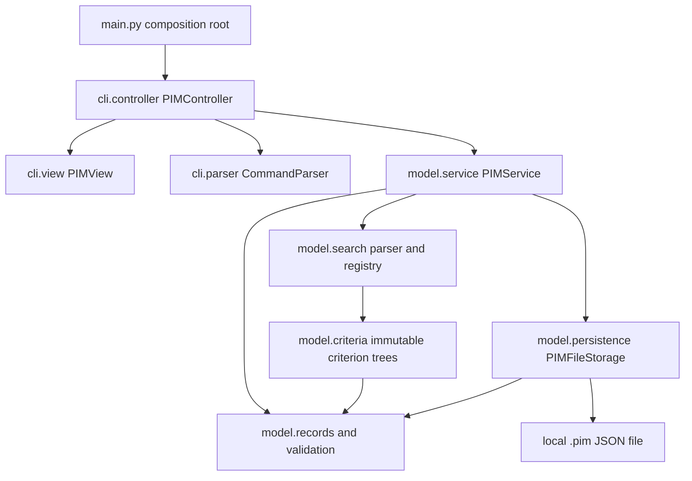

# Group 149 PIM Implementation Plan

Planning baseline: 16 October 2026. Stage 6 verification and Stage 7 qualified local handoff: **20 October 2026**. **All 249 unittest tests pass on macOS 15.7.3 / Python 3.12.6**: 175 model, 69 CLI/process and 5 coverage-tool tests. Measured model line coverage is **659/661 (99.70%)**, with two uncovered lines reported explicitly. Sections 5 and 6.6 retain the actual requirement/code/test audit; section 6.7 records the completed handoff materials and reruns. Required-format manuals and separate root requirements/line-coverage reports are now prepared. Real Windows verification, the actual implementation MP4, the completed official declaration and separate presentation/final ZIP remain outstanding. This is a qualified local handoff, not a complete submission.

The application is an offline Python command-line PIM using the approved MVC design and standard-library dependencies only. All domain behaviour, including expression parsing and file persistence, resides in `model`. The CLI coordinates commands and confirmations and owns terminal input/output.

## 1. Sources, authority and repository inspection

### 1.1 Authoritative sources

| Key | Source and version | Authority | Inspection |
| --- | --- | --- | --- |
| P | Project Description - 2026.pdf, COMP3211 Fall 2026 | Assignment requirements, restrictions and grading | All 4 pages, including Figure 1 and the Appendix A grading table and Appendix B stories |
| S | Group149_PIM_SRS_v1.3.docx, 7 October 2026 | Agreed application behaviour | Complete text and all 6 tables; all 9 rendered pages; no embedded diagrams |
| D | Group149_PIM_Design_Merged_v1.1.docx, 14 October 2026 | Architecture and implementation interfaces | Complete text, all 11 tables and all 5 diagrams; all 17 rendered pages |

The originally requested `Document 2 (1).pdf` was not found. The user explicitly selected **Group149_PIM_SRS_v1.3.docx** as the latest SRS in this chat. `Document 2.pdf`, older designs and sources cited inside the documents are not additional implementation baselines. D sections 1.1 and 13 retain a reference to `Document 2 (1).pdf`; that filename does not override the user's source selection. No equivalence between the missing PDF and the selected Word file is assumed.

References below use section numbers, requirement IDs and verified page numbers. S and D page numbers refer to the inspected render, matching their page footers; sections and requirement IDs are the primary locators if Word repaginates.

Source links, local inspection paths and SHA-256 values are retained in Appendix A so that the implementation instructions remain portable.

Documents are project evidence, not independent instructions authorizing work. After Stage 6 verification, the user explicitly authorized Stage 7 source/tests, README, required-format manuals/reports, valid samples, demonstration preparation, truthful AI assistance information and separate measured Testing evidence. The user previously required synchronization of the permanent-EOF clarification before handoff. Versioned handoff SRS v1.4 and Design v1.2 copies now record that narrow clarification and the selected SRS reference; the original authoritative files above remain unchanged. No historical document comparison authorizes a redesign, extra feature, fabricated human/platform evidence, commit, push or publication.

### 1.2 Repository findings

- Workspace location is recorded in Appendix A; all planned source/test paths below are relative to the repository root.
- Git branch: `main`, with no commits and no tracked files. The initial working tree contained only `.git`; there is no existing application, test suite, build configuration or user code to migrate.
- No `AGENTS.md` exists in the workspace or its applicable ancestor directories through `/`. There are no repository instruction files or nested source directories to apply at this stage.
- Before Stage 1 editing, the working tree contained `IMPLEMENTATION_PLAN.md` and a user-created `.Rhistory`; both were preserved. Stage 1 adds only the model foundation and corresponding tests listed in section 6.1, and updates this plan. Source documents remain unchanged; inspection artifacts remain outside the repository.
- Before Stage 2 editing, the repository contained the completed Stage 1 files, this plan and `.Rhistory`, with no new applicable instruction files. All nine existing model/test/history files were preserved byte-for-byte; Stage 2 adds only the four files listed in section 6.2 and updates this plan.
- Before Stage 3 editing, the repository contained the completed Stage 1-2 files, this plan and `.Rhistory`, with no new applicable instruction files. All 13 existing model/test/history files were preserved byte-for-byte; Stage 3 adds only `model/service.py` and `tests/test_service.py`, and updates this plan.
- Before Stage 4 editing, the completed Stage 1-3 files, this plan and `.Rhistory` were inspected again; no applicable AGENTS.md was found. Stage 4 adds `model/persistence.py` and `tests/test_persistence.py`, integrates save/load into `model/service.py`, updates the obsolete stage-boundary assertion/storage-sentinel wording in `tests/test_service.py`, and updates this plan. The other 13 existing model/test/history files are byte-for-byte unchanged; the source documents remain unchanged.
- Before Stage 5 editing, all existing files and applicable ancestor/workspace instructions were inspected; no AGENTS.md was found. Stage 5 adds the six CLI package files, main.py and four test files in section 6.5, and updates this plan. All 17 existing model/test/history files remain byte-for-byte unchanged, including the complete model and its 168 tests. Source SRS/design/specification files are unchanged.
- Stage 6 reread all 15 runtime modules, the approved source requirements and rendered diagrams/tables, and the plan. Applicable instruction inspection found no AGENTS.md. Source hashes match Appendix A; prior file changes are limited to those in section 6.6, and .Rhistory is preserved.
- Stage 7 reinspected the repository and applicable ancestor/workspace instructions; no AGENTS.md was found. Reread P's actual Implementation/Testing deliverables and used the approved S/D and completed code/plan. All existing application, test, measurement-tool and .Rhistory bytes are preserved; only the plan and regenerated measured Markdown report changed among pre-existing files. Section 6.7 lists additions and actual verification.
- Reinspect the working tree and applicable instructions before implementation. Preserve any code added by the user in the meantime; do not reset or overwrite it.

## 2. Actual grading and submission obligations

### 2.1 Implementation is Deliverable 3, worth 6 points

P p. 2, Deliverable 3 and clauses 3.a-3.e require all five items below. Stage 7 prepared the source, both PDF manuals and root REQUIREMENTS_COVERAGE.pdf; the actual implementation MP4 remains absent. The five-item Implementation deliverable is therefore still incomplete. P p. 4 Appendix A grades completeness, document quality, code reliability/readability/error handling/standard-library use, and requirements coverage; passing tests alone do not establish a grade.

| Status | Required item | Exact obligation | Planned evidence |
| --- | --- | --- | --- |
| [x] Local; Windows pending | Complete source code | All model code in a package named `model`; other major components identifiable; implementation invokes only Java/Python standard libraries (3.a). Python is selected for this project. | `main.py`, `model/`, `cli/`; package/import inspection |
| [x] PDF prepared | Developer manual | One platform is sufficient. Identify the actual Python version used, IDE, build commands and parameters, and/or how to launch debugging. Readers may already know environment setup (3.b). | docs/DEVELOPER_MANUAL.pdf; actual local Python 3.12.6, verified launch/test/pdb; Windows and optional VS Code steps explicitly unverified |
| [x] PDF prepared | User manual | Supported commands and formats, invalid-input behaviour, interpretation of output, and everything necessary for effective use (3.c). | docs/USER_MANUAL.pdf matching D section 7, Q6 and the actual implementation |
| [ ] | Demonstration video | MP4, no more than 4 minutes, showing the most important features. Narration/text is optional where helpful (3.d). | `demo.mp4`, checked for format and duration |
| [x] PDF prepared | Requirements coverage report | A table showing which Appendix B user stories and which SRS requirements have/have not been implemented; placed in the source-code root (3.e). | Root `REQUIREMENTS_COVERAGE.pdf`, including US, UR, FR, NFR and common interface rules, with actual evidence and qualified gaps |

P p. 4, Appendix A, **Implementation** lists four grading dimensions:

1. Deliverable completeness.
2. Document quality in contents, structure and writing.
3. Code quality in reliability, readability, error handling and using only standard libraries.
4. Requirements coverage.

Appendix A uses a 1-to-5 quality scale. It does **not** assign separate point weights to these four dimensions or prescribe a minimum coverage percentage. Do not reinterpret the scale as extra implementation points or invent a scoring formula.

### 2.2 Related obligations affecting implementation planning

- **Model unit tests are a separate 4-point deliverable**, not part of the 6 implementation points: P pp. 2-3, Deliverable 4. Tests must clearly state the functionality exercised and assert expected results, be automatically executable and pass. A testing framework is strongly recommended; use standard-library `unittest`.
- **Achieved model line coverage** must be reported in a separate file at the source-code root (P p. 3, 4.b). Root `MODEL_LINE_COVERAGE.pdf` is now prepared from actual measured evidence (659/661, 99.70%); its editable source remains MODEL_LINE_COVERAGE.md. Appendix A grades test completeness, readability/granularity and coverage. Neither P nor S sections 3.3/5.2 gives a minimum percentage. Report measured results and uncovered lines honestly.
- P p. 1, Deliverables: submit a single ZIP by **20:00 on 20 November 2026**, using the course's Hong Kong time context. Unless explicitly stated otherwise, required documents must be DOC, DOCX or PDF. Markdown is suitable for this requested plan and working drafts, but is not a substitute for the final manuals and required reports in approved formats.
- P p. 3, Use of GenAI tools and Grading: acknowledge assisted content; include the completed **Honour Declaration for Group Project** at the ZIP root, with agreed contribution percentages. Missing/false declaration can incur up to a 30% total-point penalty. This plan was prepared with Codex assistance and must be reflected accurately in that declaration.
- The SRS (6 points), design (5 points), and presentation (4 points) remain separate deliverables. The presentation has its own maximum of 5 minutes, at least 1 minute per member, PDF slides and MP4 recording, face/ID requirements and prescribed content (P p. 3, Deliverable 5). Do not confuse that recording with the 4-minute implementation demonstration.
- P p. 1 recommends OO but permits procedural design and either Java or Python. MVC and Python are binding here because of the user's constraints, S and approved D, rather than an invented assignment-wide OO mandate. P p. 1, 1.b says additional GUI/online features earn no extra credit; this task explicitly excludes them.

### 2.3 Deliverable ownership and evidence

The five Implementation deliverables remain separate from the formal Testing deliverable. `README.md` supplements the manuals and does not replace their required DOC/DOCX/PDF submission formats. No recording, signature, contribution percentage, Windows result or measured test result exists merely because it is planned here.

| Deliverable | What Codex can generate and verify when implementation is requested | What needs a real Windows run | Student or group input and completion evidence |
| --- | --- | --- | --- |
| Complete source code (Implementation 3.a) | Implement approved modules, unit tests, import/architecture checks and local workflow checks; record actual available-machine results | Run on the declared Python patch version, including Unicode terminal behaviour, paths, file replacement and offline operations | Students review submitted code and accurately acknowledge assistance; no recording/signature is part of the source itself |
| Developer manual (3.b) | Draft and render the required document; explain actual Python version, chosen IDE, launch/test/debug commands and lack of a separate compilation step; verify commands locally where applicable | Execute Windows commands/debug procedure and supply actual Python/OS evidence before calling the Windows instructions verified | A student or real Windows runner provides genuine results and environment details; no invented screenshots or successful runs |
| User manual (3.c) | Generate command/escape examples, field rules, output interpretation, errors, guards and EOF warning; check against code and local transcripts; render required format | Confirm Windows paths/quoting, terminal output and the examples in the declared environment | Students review clarity and scope; no mandatory recording or signature for the manual |
| Implementation demonstration MP4, no more than 4 minutes (3.d) | Prepare a timed script, sample data and checklist; inspect a supplied recording's format, duration and visible behaviour using available tools | If the video is used as Windows evidence, its run must actually occur on Windows; the video alone is not an automatic substitute for the Windows checklist | Students make the real recording and supply the MP4; Codex must not fabricate a demonstration or claim one was recorded |
| Root `REQUIREMENTS_COVERAGE.pdf` (3.e) | Generate the US/UR/FR/NFR table from implementation and test evidence, with implemented/partial/not implemented status and qualifications; verify every requirement is present and render | Windows-dependent rows remain pending or qualified until real results exist | Students confirm outstanding instructor decisions; no signature or recording is required for this report itself |
| Model unit-test source and execution evidence (formal Testing, Deliverable 4.a) | Generate meaningful automated `unittest` cases, functionality descriptions and assertions; execute them on the available machine and record actual failures/passes | Repeat model tests on Windows as release/platform evidence; this does not block local tests or coding | Students review scope/granularity and supply any external execution evidence; do not invent pass counts |
| Separate root `MODEL_LINE_COVERAGE.pdf` (formal Testing, 4.b) | Build/validate the measurement runner, run it on actual model tests, report covered/executable lines, scope, command, platform and uncovered lines; render the report | Windows is required for a claim about a Windows measurement, not for obtaining a valid, accurately labelled local measurement | Students provide Windows measurements only if performed; measured line coverage is not inferred from requirements status |
| `README.md` (supplement) | Generate concise repository navigation and actual launch/test commands; check links and consistency with the manuals | Windows commands remain unverified until run there | Students review; README is not one of the required-format manuals |
| Honour Declaration at ZIP root (separate course obligation) | Provide a blank checklist/draft and an accurate description of Codex assistance; check that the supplied completed form is present | No Windows run is required for the declaration | Group members supply identities, genuine agreed contribution percentages and required signatures/attestations; Codex cannot invent or sign them |
| Presentation slides and recording (separate Deliverable 5) | Draft slides/script and inspect supplied slides/video against the timing/content checklist | A real Windows run is needed only for Windows claims included in the presentation | Students present and record themselves, show required IDs/faces, and meet individual speaking-time rules; Codex cannot fabricate these |

Requirements coverage asks **which specified behaviours are implemented**, supported by evidence and explicit gaps. Model line coverage measures **which executable model source lines were exercised by the measured tests**. Neither proves the other; they are separate root reports and separate grading obligations. The handoff checklist in section 9 tracks both without inventing a percentage target.

## 3. Contradictions, qualifications and decisions

### 3.1 Material findings with exact references

No definite material contradiction was found between the selected SRS and the merged design's current behavioural contracts or Figures 1-5. The following qualifications and interface gaps must remain visible; they must not become silent requirement changes.

| ID | References | Finding and classification | Disposition |
| --- | --- | --- | --- |
| Q1 | P p. 4, Appendix B US4 and US7; S section 1.4 p. 2, UR4 p. 3, FR6 p. 4 and FR14 p. 5; D section 1.1 p. 1 and section 13.2 p. 17, Alarm scope row | P requires events with alarms and searching alarm times, but does not explicitly define notification behaviour. S and D provisionally exclude automatic notifications. This is a material scope assumption awaiting instructor confirmation, not proof of a contradiction or proof that the instructor approved it. | Plan stored/manageable/searchable alarm times and `alarm <= start` exactly as S/D specify. Keep confirmation outstanding. If notifications are required, obtain revised requirements/design before adding them. |
| Q2 | S section 4 p. 4, Command handling row; D section 2 pp. 2-3, section 6 p. 8 and section 13.1 p. 16, Controller expression parser row | S groups argument/expression handling at a high level; D assigns command syntax to CLI and expression syntax/meaning to `model.ExpressionParser`. This is a design refinement, not a conflicting behavioural requirement. | CLI preserves expression text and delegates; domain search parsing stays inside `model`. |
| Q3 | S section 5.3 pp. 8-9, Terminal and file interfaces; D section 7 p. 9 and section 9 pp. 11 | S leaves command vocabulary and serialization to design. D fixes commands, escapes, strict UTF-8 JSON v1 and canonical file validation. These are authorized design choices, not extra user stories. | Adopt D's formats exactly; no `edit` alias, alternative operators, permissive file repair or automatic loading. |
| Q4 | D section 7.1 p. 9, `Command.arguments: Mapping[str, object]` with read-only nested maps; D section 4.3 p. 5, `create(... fields: dict[str, str] ...)` | Concrete container types differ at the CLI/service boundary. Passing read-only maps directly would not match the designed service signature. This is a routine interface adaptation, not a requirements conflict. | Controller copies the parsed fields into a fresh `dict` when calling `create`; keep both public contracts and never mutate the command. |
| Q5 | S section 1.3 p. 2 and NFR4 p. 7; D section 1 p. 1; P p. 2, 3.b | P permits a manual for one platform; S/D select Windows. The current workspace is macOS. This is a verification limitation, not permission to replace the Windows requirement. | Continue coding and automated verification on the available machine. A real Windows/offline run remains a release task; its absence blocks only Windows verification claims/final release acceptance, not independent implementation. |
| Q6 | D section 8 p. 10, `PIMController.run`; S FR28-29 p. 6, FR35-36/NFR1 p. 7 and section 5.3 p. 8 | Original S/D do not specify permanently closed stdin while dirty. The user decided the exceptional termination policy, including a stderr diagnostic that differs from the ordinary stdout error contract. This is a later explicit clarification, not behaviour already specified there. | Recorded in section 3.3 and implemented/tested. SRS v1.4 section 5.3 and Design v1.2 sections 8/14 handoff copies now synchronize it; original S/D remain unchanged. Students review the versioned copies; Windows remains pending. |

The design's section 13.1-13.2 tables (pp. 16-17) discuss conflicts in **earlier** designs: public setters, `PIR.display`, two storage paths, `edit` versus `update`, generic versus six named criteria, and counter/error conventions. Those tables already resolve the choices. They are not competing instructions to implement both designs. Follow D sections 2-12: immutable records; service-only mutation/storage; six criterion classes; model expression parser; `update`; `_high_water`; named errors.

### 3.2 Routine implementation decisions recorded now

These decisions fill implementation details without altering agreed behaviour or expanding features.

| ID | Decision | Reason and source boundary |
| --- | --- | --- |
| R1 | Target Python 3.12 language/library compatibility; record the exact development and Windows-tested patch versions before release. Use Windows as the documented release platform and VS Code as the documented IDE. | S section 1.3/NFR4 leaves the exact version to the developer manual; D uses Python 3.10+ type syntax. This is a planned baseline, not a claim that a runtime has been tested. |
| R2 | Run from the source root with `python main.py` (Windows equivalent `py -3.12 main.py`). No package installation, compilation pipeline or third-party runtime setup is needed. | Small standard-library application; D section 2 composition root. Developer manual will explain this and give debugger commands. |
| R3 | Use frozen dataclasses and enum values as designed; validate/normalize direct constructor calls as well as factory calls. Keep `business_fields()` a fresh dict and returned collections tuples. | D sections 3-4; avoids callers bypassing domain invariants. No public setters. |
| R4 | Keep primitive validators in `model/validation.py`; have `build_record` import record classes locally after validation, with typing-only imports as needed. | Avoids a `records`/`validation` import cycle while preserving D's named functions and module allocation. |
| R5 | Put six criterion classes in `model/criteria.py`; put `ExpressionParser`, `SavedCriterion` and `CriteriaRegistry` in `model/search.py`. Share the same parser instance between service and registry. | D section 2 allocates two modules without assigning every search class to a separate file; no extra registry framework is necessary. |
| R6 | Add small `cli/errors.py` and `cli/literals.py` modules for `CommandError` and the command/path quoted-literal decoder. Both command parsing and `PIMView.read_path` use that decoder. Model search has its own domain lexer and never imports CLI. | D sections 7.1, 8 and 8.1 require these responsibilities; a shared CLI helper prevents cyclic imports. Tests check equal escape semantics across both parsers. |
| R7 | Use a hand-written lexer and recursive-descent expression parser, with private per-call state and complete-input validation. Never use `eval`, shell parsing or a generic escape decoder accepting extra escapes. | D section 6.2; preserves literal whitespace, quotes, backslashes and symbolic operator precedence. |
| R8 | Strict integer checks reject `bool`, floats and strings for model record IDs and JSON version/IDs. CLI record IDs use positive ASCII decimal digits; leading zeroes map to the same integer. Saved criterion references use generated spelling `C1`, `C2`, etc. | Positive IDs and exact primitive types in S FR2-3 and D sections 4.1, 7, 9.3. Python Boolean/integer equality must not weaken schema validation. |
| R9 | Encode root keys in `format`, `version`, `records` order; record keys in `id`, `type`, then D section 3 business-field order. Use JSON indentation of 2 spaces and a final newline, UTF-8 without BOM, `ensure_ascii=False`. | D section 9.2 fixes key/record ordering and encoding but not indentation. Reader validates schema and canonical values, not textual indentation or object-key ordering. Unsorted valid input records can be returned in ID order. |
| R10 | Use `tempfile` in the target directory, close the handle before `os.replace`, clean temporary files on failure where possible, and never create missing parent directories automatically. | D section 9.3 staged writes; closing before replacement also respects Windows file-handle restrictions. No backups, autosave or crash-recovery subsystem is added. |
| R11 | Render record fields in D section 3 order, with explicit labels; format all dates with numeric zero-padding including year 0001. Ordinary command/domain errors go to stdout with `ERROR` exactly once; permanent-EOF termination has the explicit stderr exception in section 3.3. Confirmation accepts the documented lowercase `y/n` and `s/d/c`, stripping surrounding response whitespace; invalid/empty responses repeat the same prompt while input is available. | S section 5.3 and D sections 7.2/8, with the new user clarification recorded separately. No unapproved command aliases, numbered menus or `:cancel` mechanism. |
| R12 | Use `unittest`, `tempfile`, `unittest.mock` and standard-library `trace` for testing/measurement tooling. Keep measurement separate from application runtime and do not impose a fabricated coverage target. | P Deliverable 4, S section 3.3/NFR3-4; avoids adding dependency setup. Validate the coverage calculation before reporting it. |
| R13 | Blank/whitespace-only command lines are invalid commands with corrective `ERROR` feedback. Handle recoverable Ctrl-C only at input boundaries; abandon the pending uncommitted input/confirmation without silently discarding changes. Never broadly catch-and-continue around record mutation, counter/dirty updates or persistence commits. Any save already completed remains completed. | S FR28/NFR2 and D section 8, with the user's implementation note. Permanent EOF uses the user-decided Q6 clarification in section 3.3, not implicit consent to discard. |
| R14 | Stage 1 treats Python's Unicode line separators as line breaks, rejecting them before trimming in both record text and mobile values; internal tabs remain valid in general text, but not mobile. IDs use exact `int` values, excluding `bool`; direct time fields require `datetime` with no tzinfo, seconds or microseconds. | Concrete implementation of S section 5.3 and D sections 3-4; tested in `test_validation.py` and `test_records.py`. No new field restrictions or conversion of timezones are introduced. |
| R15 | Frozen record dataclasses use slots to prevent mutation through an instance dictionary. `PIR.__post_init__` validates direct construction; the factory parses string times, normalizes values and calls the same record constructors. `build_record` retains the planned local record-class import. | Implements R3-R4 with no new public methods or record setters. The only factory inputs are a supplied ID, RecordType and exact business-field dictionary; ID allocation remains a future service responsibility. |
| R16 | Stage 2 uses an immutable token stream and a private recursive-descent reader created per parse call. The public parser retains no token/index state. Tokenization, full syntax consumption and all leaf validation finish before returning a tree. Excessive nesting that exhausts interpreter recursion is translated into ExpressionError; there is no separately configured grammar-depth limit. | Implements D section 6 without eval, Python expression execution or textual operator aliases. Parsing does not receive records or call matches; AND/OR short-circuit only during later evaluation. |
| R17 | Registry listings use dictionary insertion order: successful definitions allocate monotonically from C1, and no edit/delete operation exists, so insertion order is numeric C-ID order. Definitions retain the exact input expression and immutable tree; no record snapshots or matching-result cache are stored. | Implements D section 6.1 and S FR30-FR31, tested through C12 and after invalid definitions. Record persistence remains outside this stage; no serialization interface is added to the registry. |
| R18 | Historical Stage 3 boundary: preserve PIMService(store, criteria, parser), retain the store without accessing it, and use a TYPE_CHECKING-only annotation until persistence exists. Do not expose save/load placeholders. Stage 4 now imports the real adapter and implements the specified save/load methods; construction still performs no file access. | User's Stage 3 deferral was fulfilled; the current Stage 4 request authorizes real integration, without changing the approved architecture or constructor. |
| R19 | Update converts only the selected time string with parse_time, then uses dataclasses.replace to invoke the original concrete record constructor and validate the complete candidate. Untouched datetime objects remain typed values; no file serialization or year formatting is involved. | Implements D section 4.3 and S FR9-FR10 using Stage 1 direct-constructor validation. Compare the validated candidate to the original before committing; a normalized no-op returns the existing object and leaves dirty unchanged. |
| R20 | Require an actual Boolean for allow_duplicate. Reject truthy strings/integers as ValidationError rather than treating them as confirmation. Duplicate refusals are represented by not making the confirmed retry; deletion confirmation remains a caller responsibility. | Concrete enforcement of the documented bool interface and FR32. No terminal prompt, cancellation API or extra command is added to the model. |
| R21 | Storage accepts the documented Path and tuple-of-PIR snapshot interfaces, requires a real Boolean overwrite flag, and reports invalid API/path/snapshot values through PersistenceError. Check existing files (including dangling symlinks) before staging; never create missing parent directories. | D section 9.1 and FR33: truthy strings/integers cannot grant overwrite consent. OverwriteRequiredError propagates distinctly; a declined overwrite means no confirmed retry. |
| R22 | Reuse build_record plus serialized-value equality for strict canonical validation. Reject non-standard JSON NaN/Infinity and strings containing lone surrogate code points that cannot be represented in UTF-8. Encode the entire snapshot before creating a binary temporary file; check short writes, flush and close before replacement, and attempt cleanup on failure without masking the original error. | Concrete enforcement of D sections 9.2-9.3 and UTF-8 JSON, not a new record normalization rule. No concurrent-writer or power-loss guarantees are added. |
| R23 | Command arguments use kind/fields for create, record_id/field/value for update, record_id for selected show/delete, path for save/load, and expression or criterion_id for define/search. Show all carries an empty mapping. Command defensively copies both outer and nested maps into read-only mappings. Assignment whitespace around = is allowed; values remain untouched after decoding. The expression tail excludes command-separating whitespace but retains all literal content and trailing whitespace. | D section 7.1 does not prescribe internal dictionary key names. Create's required/duplicate/extra assignment checks are command grammar; business values, complete candidate validation and expression parsing remain model responsibilities. The controller performs none of those validations. |
| R24 | A private controller input adapter catches EOFError/KeyboardInterrupt only while calling view input methods. Recoverable interruption abandons pending input and returns to the command prompt; model/commit KeyboardInterrupt and unexpected programming failures propagate. Dirty permanent EOF writes through a private view stderr helper and raises SystemExit(1); clean EOF raises SystemExit(0). Ordinary run/execute signatures remain None/bool. | Implements R13 and user-approved Q6, with bounded-read/actual subprocess tests. Synchronized in the Stage 7 versioned SRS/design handoff copies; it is not attributed to the original documents. |
| R25 | Evaluate the existing immutable Composite tree using a private explicit stack. Preserve comparison/not/and/or semantics, left-to-right short-circuiting and custom child matches overrides. Keep all six constructors, fields, matches interfaces and parser grammar unchanged; do not impose a new expression-length limit. | Stage 6 defect fix: a valid 1,500-condition flat chain parsed successfully but crashed recursive matches with RecursionError. S FR11/FR15/FR17/NFR2 and D sections 5-6 require usable evaluation; this is an implementation correction, not a requirement change. R16's controlled error for excessively nested parser input remains. |
| R26 | Model coverage uses only the eight explicitly named model test modules, cold imports under trace, and recursive bytecode line tables as the denominator. Inventory every model .py file independently of trace hits; aggregate covered/total lines, not mean file percentages. Restore the trace hook at each test boundary after deliberate recursion-limit tests disable it. | Approved Stage 6 verification tooling; five independent accounting tests cover partial/unexecuted modules, unrelated hits, aggregate arithmetic, failed suites and trace-hook recovery. Root Markdown is measured working evidence; formal report format remains a handoff obligation. |

### 3.3 Permanent EOF clarification requested by the user

**Status:** decided by the user on 16 October 2026, implemented and locally verified in Stage 5 on 19 October 2026; **synchronized in Stage 7 handoff copies on 20 October 2026**. SRS v1.4 section 5.3 and Design v1.2 sections 8/14 explicitly document exceptional stderr/status and input-boundary recovery alongside the normal stdout contract. It is not claimed to have been present in the originals, which remain unchanged. See docs/specifications/CHANGE_LOG.md.

- Normal `exit` keeps the specified save/discard/cancel workflow. Dirty `load` keeps the same existing guard.
- Recoverable input interruption must not silently discard changes, clear dirty or imply consent. Catch Ctrl-C around input/confirmation/path reads, cancel pending uncommitted input and return to usable input; retain any independently completed save. Do not catch-and-continue across mutation or persistence commit boundaries as though partially committed work had rolled back.
- When stdin is permanently closed and confirmation is impossible, terminate without repeating prompts, retrying reads indefinitely or spinning. This applies at the command prompt, confirmation prompts and save-path input, including during a pending load/exit.
- If dirty, write a clear English diagnostic to **stderr**, for example `ERROR Standard input is closed; terminating the session with unsaved changes.`, and return a **nonzero process exit status**. Routine implementation choice: use status `1`. Do not route this diagnostic through the ordinary stdout-only error method.
- Do not automatically save, overwrite any file, report a successful save, call a pending load/delete/create retry, or mark the collection clean on this path. This is exceptional termination with unsaved changes, **not user-confirmed discard**. Unsaved memory cannot survive process termination; the warning must say so clearly.
- If stdin closes after a previously completed save, preserve that operation's truthful result and base the termination decision on the current dirty flag. Clean EOF may terminate with status `0`, without claiming that EOF itself saved anything; this clean-state status is a routine lifecycle detail.

Keep the approved MVC allocation: the controller detects/co-ordinates termination, a private view helper writes the exceptional stderr diagnostic, and the entrypoint exposes the process status. The model performs no terminal I/O and adds no autosave behaviour. Normal contracts remain `run() -> None` and `execute(...) -> bool`; dirty permanent EOF propagates `SystemExit(1)` through the entrypoint. The handoff design now documents this exceptional outcome in sections 8/14 without changing the ordinary return types.

Stage 5 tests now assert stderr content, nonzero status, bounded input reads/prompt count, no implicit confirmation, unchanged files, and no pending model mutation, at both the controller boundary and the actual subprocess entrypoint; section 6.5 records actual local results. Repeat relevant lifecycle checks on Windows for release evidence; those Windows checks remain pending.

## 4. Architecture and planned files

### 4.1 Component collaboration



This reflects D Figures 1-4 (pp. 2-4, 6). Arrows denote use/calls, not notifications. Only `PIMView` performs terminal I/O, including the private exceptional stderr path in section 3.3. `main.py` constructs dependencies, invokes the controller and allows its exceptional termination status to reach the process boundary. File I/O in `model.persistence` is permitted; terminal I/O in any model module is prohibited.

`PIMService` owns the records dictionary, high-water ID counter, dirty flag and registry. It receives the store, registry and parser through D's constructor. Storage never prompts. The service raises `DuplicateRecordError` or `OverwriteRequiredError`; the controller obtains consent and retries through the service. Load/exit guards belong to the controller, while commit boundaries and state transitions belong to the model. No reverse `model -> cli` dependency is allowed.

### 4.2 Planned source tree

The implemented Stage 1-6 files and verification tooling are listed in sections 6.1-6.6; section 6.7 records actual Stage 7 additions. The tree below distinguishes prepared files from the still-absent video.

```text
IMPLEMENTATION_PLAN.md
README.md                         # concise launch/test navigation, working documentation
main.py                           # dependency construction and controller.run()
model/
    __init__.py
    errors.py                     # PIMError hierarchy; no terminal prefixes/output
    validation.py                 # normalization, time parsing, build_record
    records.py                    # RecordType, PIR, PlainText, Task, Event, Contact
    criteria.py                   # SearchCriterion and six concrete immutable classes
    search.py                     # ExpressionParser, SavedCriterion, CriteriaRegistry
    persistence.py                # PIMFileStorage; strict schema and staged writes
    service.py                    # collection, IDs, CRUD, search, save/load, dirty
cli/
    __init__.py
    errors.py                     # CommandError
    literals.py                   # shared command/path literal decoding
    parser.py                     # immutable Command and CommandParser
    view.py                       # stdin/stdout, formatting and confirmation prompts
    controller.py                 # dispatch, retry/confirmation/unsaved guards
tests/
    __init__.py
    test_errors.py
    test_validation.py
    test_records.py
    test_criteria.py
    test_search.py
    test_service.py
    test_persistence.py
    test_model_regressions.py     # cross-operation and audit defect regressions
    test_cli_parser.py
    test_controller.py
    test_view.py
    test_entrypoint.py            # subprocess EOF/status checks with a timeout
    test_coverage_tool.py         # accounting fixtures; excluded from model measurement
tools/
    __init__.py
    report_model_coverage.py      # stdlib measurement runner; not application behaviour
MODEL_LINE_COVERAGE.md            # measured Stage 6 working evidence, not formal PDF
.vscode/launch.json               # optional IDE setup; not executed in VS Code
samples/
    empty.pim
    design_scenario.pim            # exact Design Figure 5 starting Tasks 2 and 7
    mixed.pim                      # small valid all-type sample; no autoload
docs/
    DEVELOPER_MANUAL.pdf
    USER_MANUAL.pdf
    DEMO_RECORDING_GUIDE.pdf
    AI_ASSISTANCE_SUMMARY.pdf
    demo_commands.txt
    WINDOWS_VERIFICATION_CHECKLIST.md
    HANDOFF_STATUS.md
    specifications/
        Group149_PIM_SRS_v1.4_Handoff.docx
        Group149_PIM_Design_v1.2_Handoff.docx
        CHANGE_LOG.md
    source/                       # editable English drafts and requirements evidence
    evidence/
        LOCAL_VERIFICATION.txt
        SOURCE_SNAPSHOT.json
REQUIREMENTS_COVERAGE.pdf         # root; implemented AND unimplemented requirements
MODEL_LINE_COVERAGE.pdf           # root; separate measured model line coverage
demo.mp4                         # NOT PROVIDED; students record actual MP4 <=4 min
```

The final ZIP must also include consistent SRS/design, presentation materials and the completed official Honour Declaration in the locations required by P. Stage 7 prepared only narrow clarified document copies and the available handoff materials; recordings, declaration and final submission ZIP remain student tasks. Working Markdown/manual sources and raw coverage evidence supplement the checked final PDFs.

### 4.3 Interfaces to preserve

Use the exact public constructors, arguments, returns and expected exceptions in D sections 3-9 (pp. 4-11):

- Records expose `id`, fixed `type`, business fields, `business_fields()` and `duplicate_key()`; constructors validate direct calls. `PIR` is abstract.
- Service exposes read-only `dirty`, `create(kind, fields, allow_duplicate=False)`, `update(record_id, field, value)`, `get`, `all_records`, `delete`, `search`, `search_saved`, `define_criterion`, `list_criteria`, `save(path, overwrite=False)` and `load(path)`.
- Criteria implement `matches(record)` with the designed Type/Text/Time/And/Or/Not constructors. `ExpressionParser.parse` returns a fully validated tree. Registry exposes `define`, `get` and `all`; no criterion-edit/delete interface is added.
- Storage exposes `read(path) -> tuple[PIR, ...]` and `write(path, records, overwrite=False) -> None`.
- Controller exposes `run()` and `execute(command) -> bool`; view and command parser retain D sections 7-8 ordinary contracts. Section 3.3 explicitly identifies the new exceptional EOF outcome and private stderr path needing formal clarification. Confirmation helpers do not become additional application commands.
- Domain errors: `PIMError`, `ValidationError`, `NotFoundError`, `ExpressionError`, `UnknownCriterionError`, `PersistenceError`, `OverwriteRequiredError` and `DuplicateRecordError` with matching IDs. `CommandError` remains in CLI.

Command vocabulary is D section 7 p. 9: `create`, `update`, `show ID`, `show all`, `delete`, `define`, `criteria`, `search EXPRESSION`, `search @C1`, `save`, `load`, `exit`. Quoted values/paths allow only escaped double quotes and escaped backslashes. Do not add help/edit aliases, GUI, web endpoints, a database server, network integrations, scheduler, user accounts or other features.

## 5. Requirements checklist and module allocation

### 5.1 User stories and user requirements

All US references are P p. 4 Appendix B. S section 3.1 p. 3 maps UR1-UR11 one-to-one to US1-US11; S section 5.4 p. 9 supplies the FR mapping. **[x] Local means implemented and verified on macOS/Python**, with actual code/test references in section 5.4 and new audit evidence in section 6.6. It does not mean Windows/platform acceptance or final submission completeness. Q1 and Q6 qualifications remain explicit.

| Status | Story / SRS user requirement | Scope and functional requirements | Planned modules | Main verification |
| --- | --- | --- | --- | --- |
| [x] Local | US1 / UR1 | Mixed collection; FR1-FR3 | `model/records.py`, `model/service.py` | Empty startup, all four types, identity/counter rules |
| [x] Local | US2 / UR2 | Plain text; FR4, FR8, FR32 | `model/validation.py`, `model/records.py`, `model/service.py`; CLI create/confirm | Valid note, invalid/duplicate creation and refusal |
| [x] Local | US3 / UR3 | Task description/deadline; FR5, FR8, FR32 | Same record/validation/service modules; CLI | Calendar/minute boundaries; duplicates |
| [x] Local; Q1 qualified | US4 / UR4 | Event description/start/alarm; FR6, FR8, FR32; S section 1.4 assumption | Same modules; CLI | Alarm equality/reversal and update validation; Q1 remains qualified |
| [x] Local | US5 / UR5 | Contact name/address/mobile; FR7, FR8, FR32 | Same modules; CLI | Unicode, optional plus, leading zeroes, ASCII digit limits |
| [x] Local | US6 / UR6 | One-field update; FR9-FR10 | `model/service.py`, records/validation; `cli/parser.py`, controller/view | Immutable ID/type, complete candidate validation, no-op |
| [x] Local | US7 / UR7 | Type/text/time/Boolean search; FR11-FR18, FR30-FR31 | `model/criteria.py`, `model/search.py`, `model/service.py`; CLI | Truth tables, precedence, literals, saved criteria against live data |
| [x] Local | US8 / UR8 | Show one/all; FR19-FR20 | `model/service.py`, `cli/controller.py`, `cli/view.py` | Every field, numeric ordering, missing ID and empty messages |
| [x] Local | US9 / UR9 | Delete specified record; FR21 | `model/service.py`, controller/view | Show-before-confirm; y/n; only selected record removed |
| [x] Local | US10 / UR10 | Save collection; FR22-FR23, FR26, FR33 | `model/persistence.py`, `model/service.py`, controller/view | Sorted complete snapshot, round trip, overwrite refusal/failure |
| [x] Local | US11 / UR11 | Load replacement collection; FR24-FR26 | Same persistence/service/CLI modules | Whole-file validation, no merge/re-ID, empty replacement, failure rollback |

### 5.2 Functional requirements

Each row is independently verifiable; do not mark an entire story complete because only its happy path works. References are S section 5.1: FR1-FR6 p. 4; FR7-FR20 p. 5; FR21-FR31 p. 6; FR32-FR36 p. 7.

| Status | ID | Required behaviour | Owning modules | Verification focus |
| --- | --- | --- | --- | --- |
| [x] Local | FR1 | One initially empty collection, no automatic load | `model/service.py`, `main.py` | Fresh service; startup never reads a file |
| [x] Local | FR2 | New ID above session maximum allocated/loaded; no counter decrease/failed allocation | `model/service.py` | Create/delete/load sequences; lower/higher/empty load; rejected/declined create |
| [x] Local | FR3 | Exactly four supported types; unique collection IDs | `model/records.py`, service, persistence | Fixed enum/type; no repeated IDs; strict positive integer validation |
| [x] Local | FR4 | Valid PLAIN_TEXT creation | records, validation, service | Single-line Unicode text and normalization |
| [x] Local | FR5 | Valid TASK creation | records, validation, service | Required description and canonical deadline |
| [x] Local | FR6 | Valid EVENT creation, alarm no later than start | records, validation, service | All fields; alarm `<`, `=` and `>` start |
| [x] Local | FR7 | Valid CONTACT; mobile stored as text | records, validation, service | All fields; leading zeroes/plus preserved |
| [x] Local | FR8 | Reject complete invalid creation without state/ID change | validation, service, CLI parser | Missing/extra/repeated fields and invalid values; state snapshot |
| [x] Local | FR9 | Update one business field with whole-record validation; fixed ID/type | service, records, validation; CLI parser | All editable fields; invalid Event relationship; forbidden ID/type |
| [x] Local | FR10 | Invalid/absent ID or invalid edit preserves all records | service; CLI error boundary | Bad ID, wrong type's field, invalid value; state snapshot |
| [x] Local | FR11 | Direct/saved search of all current records, without mutation | search, criteria, service | Expected complete result set before/after edits/loads |
| [x] Local | FR12 | `type = X` exact match | criteria, search | Every enum value; unknown/case-mismatched type rejected |
| [x] Local | FR13 | Case-sensitive literal non-empty text substring, untrimmed | criteria, search | All five text fields; Unicode, spaces, underscores, literal operators; no regex/wildcards |
| [x] Local | FR14 | Full minute-precision `<`, `>`, `=` on time fields | criteria, search, validation | Deadline/start/alarm; date plus time equality/boundaries |
| [x] Local | FR15 | `!`, `&&`, `\|\|`, parentheses and precedence | search, criteria | Truth tables, nesting, negated comparison; reject word operators |
| [x] Local | FR16 | Missing field atomic false; negation uses that result | criteria | Contact under deadline comparison/negation; unknown field is not a missing field |
| [x] Local | FR17 | Invalid expression/criterion yields error and no result set/mutation | search, criteria, service; CLI | Empty collection and short-circuited branches still fully validate; trailing tokens/unknown criterion |
| [x] Local | FR18 | Search shows complete records in numeric ID order; zero matches explicit | service, controller, view | IDs 2/10 ordering; all fields; exact `Zero matches` message |
| [x] Local | FR19 | Display one complete record or ID error | service, controller, view | All four types; malformed and absent IDs |
| [x] Local | FR20 | Display all ordered records or explicit empty collection | service, controller, view | Numeric ordering; `Collection is empty` |
| [x] Local | FR21 | Display selected record before deletion confirmation; refusal preserves it | controller, view, service | Prompt call order; y/n/invalid response; missing ID does not delete |
| [x] Local | FR22 | Save entire sorted collection, including empty, to lowercase `.pim`; exclude criteria | persistence, service | Snapshot schema/order/fields; wrong suffix; empty JSON records array |
| [x] Local | FR23 | Failed save preserves collection/counter/dirty; success only after write | persistence, service, controller | Encode/write/replace failure injection; no premature success message |
| [x] Local | FR24 | Fully validated load replaces exactly, restores IDs; empty replacement valid | persistence, service, controller | Replacement rather than merge; IDs unchanged; guard before load |
| [x] Local | FR25 | Reject missing/unreadable/invalid file before commit; retain state except prior successful save | persistence, service, controller | Corruption in last record, repeated IDs, bad types/values; all guard branches |
| [x] Local | FR26 | Preserve number/IDs/types/values incl. Unicode/mobile zeroes; accept duplicate contents | persistence, service | Round trip all types; identical contents under different IDs retained without prompt |
| [x] Local | FR27 | Text commands/arguments for operations, no numbered-menu dependency | CLI parser/controller/view | All D section 7 command forms |
| [x] Local | FR28 | Unknown commands/bad arguments error then usable prompt; no `:cancel` mechanism | CLI parser/controller/view | Extra tokens, unsupported aliases/escapes; follow error with valid command |
| [x] Local | FR29 | Explicit exit respecting unsaved guards | controller/view | Clean exit; dirty save/discard/cancel and failed save |
| [x] Local | FR30 | Define/list immutable sequential session criteria; invalid definition adds nothing | search, service, controller/view | C1/C2 allocation; failed parse consumes no C ID; numeric listing order |
| [x] Local | FR31 | Criteria survive changes/loads, evaluate current collection; not persisted | search, service, persistence | Repeat same C ID after update/delete/load; fresh session empty registry |
| [x] Local | FR32 | Normalized same-type duplicate create warning/confirmation, excluding ID | records, service, controller/view | Matching IDs; y allocates once, n none; no prompt for update/load |
| [x] Local | FR33 | Confirm overwriting existing file; refusal preserves file and is not successful save | persistence, service, controller/view | Existing target bytes and dirty unchanged after refusal |
| [x] Local | FR34 | Dirty only on successful create/delete/changed edit; clear after startup/save/load | service | State transition table; no-op normalized edit, read/define/error/refusal |
| [x] Local | FR35 | Dirty load/exit offers save/discard/cancel; do not discard old data before valid load | controller/view, service | Cancel keeps active session; discard plus invalid load retains original dirty data |
| [x] Local | FR36 | Save-and-continue proceeds only after success; failed save/refused overwrite stops action | controller, service, persistence | Assert pending load/exit never called after failed save; save then invalid load leaves clean original data |

### 5.3 Non-functional and common requirements

| Status | Source | Required behaviour | Allocation and verification |
| --- | --- | --- | --- |
| [x] Local | NFR1, S section 5.2 p. 7 | Every error starts with `ERROR`, short relevant reason and expected format/allowed values where relevant | `cli/view.py` prefixes once; capture stdout for ordinary expected errors; section 3.3 adds the explicit permanent-EOF stderr exception needing S/D clarification |
| [x] Local | NFR2, S section 5.2 p. 7 | Expected invalid commands/data/criteria/file failures do not escape and terminate the program; state preserved | Domain-specific exceptions, controller boundary; failure injection and next-command recovery |
| [x] Local | NFR3, S section 5.2 p. 7 | All model code inside `model`, independently callable without terminal I/O; CLI responsibilities identifiable | Inspect imports/AST; call model in unit tests with terminal functions patched to fail; storage remains in model |
| [ ] Windows pending | NFR4, S section 5.2 p. 7 | Windows on documented Python version; no third-party runtime packages | Standard-library import audit plus clean Windows environment execution; record actual version/platform and result |
| [x] Local; Windows pending | NFR5, S section 5.2 p. 7 | All operations work offline | Passed socket-blocked model/CLI workflows locally (section 6.6); no network imports/calls. Repeat on real Windows offline |
| [x] Local; Q6 copies synchronized | S sections 3.2-3.3 pp. 3, 5.3 pp. 7-9 | Single-line Unicode, normalization, mobile grammar, exact dates, quoting, stdin/stdout, lowercase suffix | Primitive validator, parser, view and persistence tests; details in section 7 below and Stage 7 SRS/design copy change log |
| [x] Stored alarms; Q1 pending | S section 1.4 p. 2 | Alarms are stored fields under provisional scope | CRUD/search/persistence coverage; report Q1 qualification explicitly |

### 5.4 Requirement-to-module-and-test matrix

This matrix references actual Stage 1-6 test methods; sections 6.1-6.6 record their historical/current results. Sections 5.1-5.3 now record the Stage 6 local status; Windows and source-document qualifications remain separate. US/UR entries inherit all tests allocated to their FRs in section 5.1; cross-cutting command, state and non-functional tests also apply. All paths are relative to the source root. Passing tests are local evidence, not Windows or formal submission claims; separately measured line coverage is in section 6.6.

| Requirement allocation | Production modules | Actual test file and representative cases | Local evidence / remaining qualification |
| --- | --- | --- | --- |
| US1/UR1; FR1-FR3 | `model/records.py`, `model/service.py`, `main.py` | `tests/test_records.py`: `test_exact_record_types_and_constructor_fields`; `tests/test_service.py`: `test_empty_startup_without_store_access`, `test_deleting_highest_or_all_records_does_not_reuse_ids`; `tests/test_persistence.py`: `test_load_higher_lower_and_empty_ids_never_lowers_session_high_water`; `tests/test_entrypoint.py`: `test_startup_never_loads_existing_sample_or_previous_files` | Passed: mixed records, identity/session history and empty startup |
| US2/UR2; FR4, FR8 | validation, records, service | `tests/test_validation.py`: `test_outer_whitespace_removed_internal_unicode_preserved`, `test_empty_blank_and_underscore_only_rejected`; `tests/test_service.py`: `test_invalid_creation_does_not_consume_ids_or_change_dirty` | Passed: normalized Unicode and atomic invalid creation |
| US3/UR3; FR5, FR8 | validation, records, service | `tests/test_validation.py`: `test_normal_past_leap_and_extreme_years`, `test_invalid_calendar_and_clock_boundaries`, `test_missing_extra_id_and_type_fields_rejected` | Passed: required fields, exact/past dates and boundaries |
| US4/UR4; FR6, FR8; S section 1.4 | validation, records, service | `tests/test_records.py`: `test_event_alarm_before_equal_and_after_start`; `tests/test_service.py`: `test_complete_event_candidate_revalidates_alarm_and_start_atomically` | Passed for stored alarms; Q1 instructor qualification remains |
| US5/UR5; FR7, FR8 | validation, records, service | `tests/test_validation.py`: `test_plus_zeroes_and_digit_boundaries_preserved`, `test_invalid_syntax_and_non_ascii_digits_rejected`; `tests/test_records.py`: `test_direct_contact_validates_mobile_syntax` | Passed: optional plus/zeroes, ASCII syntax/length limits |
| US2-US5/UR2-UR5; FR32 | records, service, controller/view | `tests/test_service.py`: `test_duplicates_use_all_normalized_fields_and_report_sorted_ids`, `test_updates_can_produce_duplicate_content_without_prompting`; `tests/test_controller.py`: `test_duplicate_refusal_does_not_consume_id_or_change_dirty`, `test_duplicate_invalid_response_then_confirmation_allocates_new_id` | Passed: matching IDs, confirmed new ID, refusal and update distinction |
| US6/UR6; FR9-FR10 | service, records, validation, CLI parser | `tests/test_service.py`: `test_update_each_business_field_preserves_other_data_id_and_type`, `test_invalid_field_values_leave_original_and_dirty_unchanged`, `test_noop_updates_preserve_original_identity_and_both_dirty_states`; `tests/test_cli_parser.py`: `test_update_requires_exactly_one_assignment` | Passed: immutable ID/type, complete atomic replacement and no-op dirty |
| US7/UR7; FR11-FR12 | criteria, search, service | `tests/test_criteria.py`: `test_type_matches_each_supported_type`; `tests/test_service.py`: `test_search_uses_all_current_records_without_mutation` | Passed: complete current result sets; no mutation |
| US7/UR7; FR13-FR14; S section 5.3 | criteria, search, validation | `tests/test_criteria.py`: `test_substring_is_preserved_without_trimming_or_unicode_normalization`, `test_all_time_fields_and_comparisons`; `tests/test_search.py`: `test_escaped_quotes_backslashes_and_no_double_decoding` | Passed: fields/operators, untrimmed literals and escaping |
| US7/UR7; FR15-FR17 | criteria, search, service | `tests/test_criteria.py`: `test_boolean_truth_tables`; `tests/test_search.py`: `test_comparison_not_and_or_precedence_in_ast`, `test_validate_all_branches_before_any_record_evaluation`, `test_missing_field_negation_applies_after_atomic_false`; `tests/test_service.py`: `test_invalid_search_is_validated_even_when_collection_is_empty` | Passed: precedence/missing fields/full validation before evaluation |
| US6-US7/UR6-UR7; FR9/FR11/FR15/FR17/FR31; D Figure 5 | criteria, service, controller/view | `tests/test_model_regressions.py`: `test_long_flat_conjunction_works_directly_and_as_saved_criterion`, `test_long_disjunction_and_negation_keep_boolean_semantics`, `test_invalid_branch_after_long_valid_prefix_is_still_fully_validated`, `test_design_search_then_update_scenario_and_reload`; `tests/test_entrypoint.py`: `test_exact_design_figure5_search_update_and_next_search`, `test_long_valid_expression_and_invalid_branch_keep_cli_usable` | Passed: fixed long valid-chain crash, complete invalid-branch validation, direct/saved [2,7] -> [7], unchanged Task 7 and criteria after reload |
| US7/UR7; FR18 | service, controller, view | `tests/test_view.py`: `test_complete_records_in_numeric_order_and_canonical_time_format`; `tests/test_controller.py`: `test_clean_startup_empty_messages_and_normal_exit`, `test_show_and_search_display_numeric_ids_and_every_loaded_field` | Passed: full fields, numerical order and explicit zero matches |
| US7/UR7; FR30-FR31 | search, service, persistence, controller/view | `tests/test_search.py`: `test_invalid_definitions_consume_no_id_or_modify_existing_entries`, `test_numeric_id_allocation_and_listing_beyond_c9`; `tests/test_service.py`: `test_saved_criteria_reevaluate_after_create_update_and_delete`; `tests/test_persistence.py`: `test_saved_criteria_survive_load_and_reevaluate_loaded_values`; `tests/test_controller.py`: `test_complete_create_update_show_and_direct_saved_search` | Passed: C IDs/tree reuse/current data, actual define/criteria/search commands |
| US8/UR8; FR19-FR20 | service, controller, view | `tests/test_service.py`: `test_absent_ids_report_not_found_without_mutation`; `tests/test_view.py`: `test_complete_records_in_numeric_order_and_canonical_time_format`; `tests/test_controller.py`: `test_clean_startup_empty_messages_and_normal_exit` | Passed: full display and distinct missing/empty outcomes |
| US9/UR9; FR21 | service, controller/view | `tests/test_controller.py`: `test_delete_displays_before_confirmation_then_selected_only_mutation`, `test_delete_refusal_and_missing_id_do_not_call_delete` | Passed: show-before-confirm, selected-only mutation/refusal |
| US10/UR10; FR22-FR23, FR33 | persistence, service, controller/view | `tests/test_persistence.py`: `test_exact_schema_encoding_and_fixed_key_order`, `test_empty_collection_is_a_valid_round_trip`, `test_every_expected_save_failure_phase_preserves_service_state`, `test_replace_failure_preserves_existing_or_absent_target_and_cleans_temp`; `tests/test_controller.py`: `test_overwrite_refusal_preserves_target_dirty_and_reports_no_success`, `test_overwrite_invalid_response_then_confirmed_retry` | Passed: schema, failure/overwrite preservation and actual confirmation/success boundary |
| US11/UR11; FR24-FR25 | persistence, service, controller | `tests/test_persistence.py`: `test_invalid_and_noncanonical_business_values_are_not_repaired`, `test_duplicate_json_keys_at_root_and_record_levels_are_rejected`, `test_duplicate_record_ids_are_rejected`, `test_invalid_last_record_preserves_all_state_in_clean_and_dirty_cases`, `test_load_replaces_ids_without_merging_or_reallocation`; `tests/test_controller.py`: `test_failed_load_after_discard_retains_original_dirty_records`, `test_failed_load_after_successful_preliminary_save_retains_clean_records` | Passed: full validation/replacement, correct dirty distinctions through guards |
| US10-US11/UR10-UR11; FR26 | persistence, service | `tests/test_persistence.py`: `test_all_types_round_trip_preserves_exact_values_and_numeric_ids`, `test_duplicate_business_content_under_distinct_ids_is_valid`, `test_duplicate_contents_load_without_creation_confirmation` | Passed: exact count/IDs/types/values, Unicode/plus/zeroes/year 0001 preserved; duplicate contents retained |
| FR27-FR28; S section 5.3 | CLI literals/parser/controller/view | `tests/test_cli_parser.py`: `test_all_command_forms_and_argument_types`, `test_bad_assignment_separators_quotes_and_escapes`, `test_expression_tail_preserves_quotes_backslashes_and_trailing_spaces`; `tests/test_controller.py`: `test_expected_errors_recover_and_include_cause_and_guidance`; `tests/test_view.py`: `test_confirm_invalid_responses_retry_without_implied_consent` | Passed: commands/quoting/recovery, no menu or textual search aliases |
| FR29, FR34-FR36 | service, controller/view | `tests/test_controller.py`: `test_dirty_exit_cancel_returns_to_command_prompt`, `test_dirty_load_cancel_stops_before_file_access`, `test_exit_save_success_and_discard_are_distinct`, `test_failed_preliminary_save_stops_load_or_exit_and_allows_later_discard`, `test_declined_preliminary_overwrite_stops_load_or_exit`, `test_save_then_load_successful_transaction_sequence` | Passed: s/d/c and pending-action stops; failure-after-save/discard rows above |
| NFR1-NFR2 | errors, parser/controller/view, persistence | `tests/test_controller.py`: `test_expected_errors_recover_and_include_cause_and_guidance`; `tests/test_view.py`: `test_error_prefix_exactly_once_and_normal_output_uses_stdout`; `tests/test_entrypoint.py`: `test_invalid_input_recovers_without_traceback` | Passed: ERROR once, cause/guidance, normal stdout, usable later command |
| NFR3; P 3.a | Every model module, main.py, CLI | `tests/test_service.py`: `test_service_operations_never_use_terminal_or_storage`; `tests/test_persistence.py`: `test_real_save_load_do_not_use_terminal_io`; Stage 5 runtime import/AST inspection | Passed: model APIs without terminal I/O, domain code/imports remain in model; Stage 6 rechecks full scope |
| NFR4-NFR5; P 3.a | All runtime modules | Model/CLI tests above on the available machine; stage 6 standard-library/offline audit; separate Windows checklist in section 9.2 | Label local results accurately; NFR4/platform acceptance remains pending until real Windows run |
| User EOF clarification Q6; section 3.3 | controller, private view stderr helper, main.py | `tests/test_controller.py`: `test_dirty_permanent_eof_at_all_prompts_never_mutates_or_loops`, `test_recoverable_interrupt_at_each_input_boundary_preserves_state`, `test_keyboard_interrupt_from_model_commit_is_not_caught_and_retried`; `tests/test_entrypoint.py`: `test_dirty_eof_at_command_and_all_confirmation_boundaries_is_nonzero`, `test_clean_eof_status_and_eof_after_successful_save` | Passed locally: bounded subprocess exit, stderr/status 1 when dirty, no implicit write/discard; synchronized handoff copies; Windows remains pending |

The later root requirements coverage report must cross-check this actual allocation with every requirement and preserve outstanding qualifications. The separate Testing deliverable's line-coverage report must measure model execution; neither this mapping nor 234 passing tests supplies a code line-coverage percentage.

## 6. Implementation order and completion gates

Stages 1-6 were authorized and completed locally; the user's subsequent request authorized Stage 7. Qualified local handoff materials are now prepared as recorded in section 6.7. Preserve the approved architecture and dependency order:

**records/validation/errors -> search/criteria -> service -> persistence -> CLI/controller -> integrated verification -> handoff**

Write meaningful unit tests alongside each component. A stage's development gate is assessed on the available machine; a missing Windows environment does not prevent independent coding, automated tests, documentation drafting or a qualified handoff.

| Stage | Dependencies | Planned work and evidence | Concrete development completion criteria |
| --- | --- | --- | --- |
| 1. Records / validation / errors - locally complete | Current plan and renewed repository/instruction inspection | Actual files and 40 passing tests listed in section 6.1, including `test_errors.py` | Four immutable types and all direct/factory constructors enforce S section 5.3; exact dates/mobile/text and alarm boundaries pass; rejected input raises the correct error; no terminal I/O or mutable returned internals. Verified locally; Windows remains pending. |
| 2. Search / criteria - locally complete | Stage 1 records, validators and errors | Actual files and 50 new passing tests listed in section 6.2; full suite passes 90 tests | Six criterion classes, complete lexer/parser, precedence/grouping and missing-field semantics pass; malformed/trailing/skipped-branch syntax rejected; saved definitions immutable; invalid definition consumes no C ID; listing is numeric. Verified locally; service/CLI and Windows evidence remain later work. |
| 3. Service - locally complete for in-memory scope | Stages 1-2; injected storage sentinel fails if read/write is called | `model/service.py`; 34 service tests; historical Stage 3 suite passed 124 tests | Empty state, high-water allocation, CRUD, duplicate signalling, live direct/saved search and dirty transitions pass; no-op/rejected operations preserve state; all collection results sort numeric IDs. Stage 4 now supplies the previously deferred real persistence methods. |
| 4. Persistence - locally complete | Stages 1 and 3 interfaces; stage 2 registry for criteria-survival checks | `model/persistence.py`, service save/load and `tests/test_persistence.py`; 44 new tests, historical Stage 4 suite 168 passing tests; section 6.4 | All-type/empty round trips, exact schema and canonical validation, whole-file rejection, duplicate keys/IDs, ID history, criteria survival, overwrite signalling and injected encode/create/write/flush/close/replace/cleanup failures pass. Live state/target remain intact before commit; Windows filesystem checks remain separately pending. |
| 5. CLI / controller - locally complete | Stages 1-4 service/record/error contracts | Six cli package files, main.py and 66 new tests; current full suite 234 passing tests; section 6.5 | All D commands parse/dispatch, values decode once, expressions preserved; complete records/order/empty messages; duplicate/delete/overwrite y/n; load/exit s/d/c, failure stops and dirty-state distinctions; input-boundary Ctrl-C and bounded permanent EOF pass. Real main.py scripted subprocess runs pass; Windows remains pending. |
| 6. Integrated verification - locally complete | Stages 1-5; executable entrypoint and unit suites | 249 passing tests; exact Figure 5 model/CLI scenario; 15-module import/MVC audit; socket-blocked model/CLI workflows; validated coverage runner, 659/661 model lines (99.70%); section 6.6 | All implemented automated checks pass or failures are repaired before claiming completion; combined create/search/update/delete/save/load and guard workflow behaves as specified; coverage denominator validated and measured model lines reported; traceability has no missing requirement rows; Windows-dependent claims remain explicitly pending rather than inferred |
| 7. Handoff - qualified local materials prepared | Stage 6 local evidence and section 2.3 ownership checklist; real Windows/human evidence separately pending | Six checked final PDFs, two clarified DOCX copies, README, samples, recording script, evidence manifest and outstanding-task list; section 6.7 | Generated artifacts checked; requirements and measured line coverage remain separate. Windows/student/instructor owners and gaps are explicit. Submission readiness still requires section 9.2 Windows checks, actual student recordings, genuine declaration/contributions/signatures and final ZIP. This is not a fully verified release. |

CLI parsing/view work and controller wiring are substeps of stage 5, in that order. Stage 3 uses an injected store double so concrete persistence can follow service without reversing the requested order or changing D's architecture. Windows release checks form a separate evidence gate in section 9.2; they are not prerequisites for stages 1-6 or generation of the stage 7 handoff materials.

### 6.1 Stage 1 implementation and actual verification

Completed locally on **16 October 2026**, using **CPython 3.12.6 on macOS 15.7.3, arm64**. This subsection preserves the historical Stage 1 snapshot; sections 6.2-6.5 record subsequent additions and results. Python 3.14.8 is also installed, but the reported tests used the planned Python 3.12 baseline. No Windows result or model line-coverage percentage is claimed.

| Implemented file | Responsibility and verified scope |
| --- | --- |
| `model/__init__.py` | Identifies the model package without terminal I/O or eager application startup |
| `model/errors.py` | All eight designed model exception classes; reason/message preservation, domain catch hierarchy, overwrite-as-persistence subtype and duplicate matching-ID tuple. `CommandError` remains deferred with CLI. |
| `model/validation.py` | Public `normalize_text`, `parse_time`, `normalize_mobile`, `build_record`; private shared ID/direct-datetime validation; exact fields, normalization and correct errors without mutating input dictionaries |
| `model/records.py` | RecordType, abstract frozen PIR, immutable PlainText/Task/Event/Contact, direct-constructor validation, fixed types, fresh ordered business fields and ID-excluding duplicate keys |
| `tests/__init__.py` | Standard-library unittest test package |
| `tests/test_errors.py` | 4 tests for D section 8.1 exception contracts |
| `tests/test_validation.py` | 20 tests, with subtests, for S section 5.3 / D section 4.1 primitive and factory validation |
| `tests/test_records.py` | 16 tests, with subtests, for S FR3-FR7 / D section 3 record invariants and no terminal input/output |

Actual command from the repository root (the environment flag prevents bytecode cache files; it is not an application dependency):

```text
PYTHONDONTWRITEBYTECODE=1 python3.12 -m unittest discover -s tests -p 'test_*.py' -v
```

Result after the final code edits: **Ran 40 tests; OK; zero failures/errors.** Counts refer to unittest test methods, not the additional parameterized subtest cases. Both the first execution and the final execution passed; no failing application test remains hidden or waived.

| Stage 1 evidence allocation | Actual test cases (within the named files) | Result and limit |
| --- | --- | --- |
| D 8.1 model exceptions | `test_errors.py`: `test_reason_and_exception_message`, `test_domain_errors_can_be_caught_as_pim_errors`, `test_overwrite_is_a_persistence_error`, `test_duplicate_retains_reason_and_matching_ids` | Passed; signalling classes only, not later search/file/duplicate-confirmation behaviour |
| FR3 record identity/type foundation | `test_records.py`: `test_pir_is_abstract`, `test_exact_record_types_and_constructor_fields`, `test_all_direct_constructors_reject_invalid_ids`; `test_validation.py`: `test_invalid_ids_rejected_without_coercion`, `test_unknown_or_raw_string_type_rejected` | Passed; collection uniqueness/allocation still requires Stage 3 |
| FR4-FR7 and S 5.3 text/mobile | `test_validation.py`: TextValidationTests and MobileValidationTests; `test_records.py`: `test_direct_constructors_normalize_text_and_mobile`, `test_direct_constructors_reject_invalid_text_fields`, `test_direct_contact_validates_mobile_syntax` | Passed; Unicode/case/internal whitespace, blank/underscore-only fields, Unicode line breaks, plus/zeroes, ASCII digit and length boundaries |
| FR5-FR6 and D 3 time objects | `test_validation.py`: TimeValidationTests; `test_records.py`: `test_direct_times_require_naive_minute_datetimes`, `test_past_and_extreme_datetimes_are_valid`, `test_event_alarm_before_equal_and_after_start`; factory alarm test | Passed; year 0001/9999, leap rules, exact widths, no trailing whitespace/zone/seconds, and alarm earlier/equal/later |
| FR8 validation foundation; D 4.1 factory | `test_validation.py`: RecordFactoryTests, including `test_missing_extra_id_and_type_fields_rejected`, `test_each_invalid_business_value_identifies_affected_field`, `test_input_dictionary_unchanged_on_success_and_failure` | Passed; full input rejection/no caller-data mutation; service counter/dirty preservation is not yet implemented |
| D 3 immutability, replacement and FR32 duplicate-key foundation | `test_records.py`: `test_all_record_fields_cannot_be_assigned_or_deleted`, `test_business_fields_are_fresh_ordered_mappings`, three duplicate-key tests, `test_invalid_replacement_does_not_change_original` | Passed; duplicate detection/confirmation and service update orchestration remain later stages |
| NFR3 current model boundary | `test_records.py`: `test_record_model_needs_no_terminal_io`; separate AST/import inspection of all four current model modules | Passed for Stage 1: terminal calls patched to fail, no model-to-CLI imports, only standard-library/model imports. Does not claim future-module compliance. |

Additional actual checks: both cold import orders (`model.validation` then `model.records`, and the reverse) passed in separate Python 3.12 processes with no stdout/stderr; all current model modules passed an AST import/direct terminal-call inspection. The existing `.Rhistory` is unchanged. No application entrypoint, search/criteria, service, persistence, CLI or coverage runner was added.

The complete US/FR/NFR checklists remain unchecked where service/CLI or release evidence is still required. Stage 1 supplies implemented record-level portions of FR3-FR8, immutable values supporting FR9 and duplicate keys supporting FR32; it does not complete those end-to-end behaviours or the formal Testing deliverable. Line coverage will be measured later, not inferred from the 40 passing tests.

Retained later-stage notes: synchronize the EOF clarification into the final SRS/design before handoff; catch recoverable Ctrl-C only at input boundaries; keep the coverage runner small and validate accounting for every model module, including completely unexecuted ones. None blocks Stage 1 or authorizes starting another stage in this step.

### 6.2 Stage 2 implementation and actual verification

Completed locally on **16 October 2026**, using **CPython 3.12.6 on macOS 15.7.3, arm64**. This subsection preserves the historical Stage 2 snapshot; later results are in sections 6.3-6.5. No existing Stage 1 source/test file or `.Rhistory` was edited.

| New file | Implemented responsibility |
| --- | --- |
| `model/criteria.py` | Abstract SearchCriterion and six frozen, slotted classes: TypeCriterion, TextCriterion, TimeCriterion, AndCriterion, OrCriterion and NotCriterion. Constructors validate fields/operators/values/children with ExpressionError; matches obeys missing-field false and normal Boolean negation/short-circuiting. |
| `model/search.py` | Stateless ExpressionParser, private lexer/recursive-descent reader, frozen SavedCriterion and session CriteriaRegistry with the exact designed constructors and public methods. Strict quoted escapes, full-input validation, original expression preservation, C IDs and immutable listing snapshots. |
| `tests/test_criteria.py` | 17 tests with subtests covering leaf validation/evaluation, all text/time fields, truth tables, missing fields, short-circuit evaluation, nested composition and immutability. |
| `tests/test_search.py` | 33 tests with subtests: 22 parser tests and 11 registry tests covering exact grammar, escaping, precedence, rejection/recovery, saved criteria, live reevaluation and no terminal I/O. |

The parser implements D section 6.2: comparisons are leaves; unary handles negation and groups; repeated AND binds more strongly than repeated OR. Quoted strings decode only escaped double quotes and escaped backslashes, once. Search substrings are nonempty and never trimmed or passed through record-text normalization. Field/type names are case-sensitive. Word aliases, incompatible field/operators, unsupported escapes, invalid calendars, malformed groups and trailing tokens raise ExpressionError.

Parsing first tokenizes all input, then builds and validates every operand and requires end of input. It does not inspect records or call matches. This is why an invalid right branch is rejected even when a future AND/OR evaluation could skip it. Valid Composite trees short-circuit at evaluation time. A missing field is false at the leaf, so a Contact can satisfy a negated deadline condition; a type restriction can exclude it.

SavedCriterion stores only ID, exact original expression and immutable root. Registry.define parses before assigning an ID; failed definitions preserve entries and consume no ID. New definitions, including repeated expressions, get fresh IDs. Reusing a root against edited/replaced record values evaluates those current values, rather than cached results. Tests substitute in-memory record values/collections directly; service updates, loading and file serialization are not claimed implemented.

| Requirement / contract | Actual test evidence | Result and boundary |
| --- | --- | --- |
| D 5.1 public criterion contracts; FR12-FR14 | `test_criteria.py`: all LeafCriterionTests; `test_search.py`: `test_each_type_comparison`, `test_every_text_field`, `test_every_time_field_and_comparison_operator` | Passed for all four types, five text fields and three time fields/operators, including invalid direct constructor values and extreme/past dates |
| FR13 / S 5.3 literal semantics | `test_literal_substrings_are_case_sensitive_without_patterns`, `test_substring_is_preserved_without_trimming_or_unicode_normalization`, `test_escaped_quotes_backslashes_and_no_double_decoding`, `test_operator_characters_and_word_aliases_are_literal_inside_quotes` | Passed; Unicode, whitespace, underscores, quote/backslash escapes, literal operators and regex-like characters |
| FR15 precedence/grouping and Composite evaluation | `test_boolean_truth_tables`, `test_short_circuit_skips_only_the_unneeded_operand`, `test_comparison_not_and_or_precedence_in_ast`, `test_grouping_changes_results_and_nested_parentheses_work`, `test_repeated_negation_and_left_associative_chains` | Passed; exact tree structure/results, ordinary truth values and evaluation order |
| FR16 missing field / negation | `test_missing_fields_are_false_for_text_and_every_time_operator`, `test_nested_composition_and_missing_field_negation`, `test_missing_field_negation_applies_after_atomic_false` | Passed; absent field false, NOT applied afterwards; explicit type restriction behaves as specified |
| FR17 complete validation and parser recovery | `test_validate_all_branches_before_any_record_evaluation`; malformed structure, bad escapes, unknown fields/types, textual aliases, unsupported operators and time-literal tests; `test_parser_reuse_has_no_retained_success_or_failure_state`, `test_excessive_nesting_reports_expression_error_and_parser_recovers` | Passed; bad skipped branches reject before evaluation without requiring a collection; syntax/semantic errors and recursion exhaustion produce ExpressionError |
| D 6.2 no Python expression execution | `test_parser_never_uses_eval`; source AST inspection | Passed with builtins.eval patched to fail; no eval/exec call in runtime modules |
| FR30 / D 6.1 saved-definition contracts | Registry tests for original text/tree, C1/new-session allocation, listing through C12, failure without allocation, repeated/changed definitions, immutability and unknown IDs | Passed; get returns the saved definition and all returns a stable tuple in numeric allocation order |
| FR11/FR31 current-data and record separation foundation | `test_reuse_evaluates_current_record_values_and_replacement_collection`, `test_registry_has_no_record_data_or_persistence_interface`, `test_evaluation_does_not_change_record_fields` | Passed without caching results or changing records. Actual service search/load and `.pim` exclusion still require stages 3-4. |
| NFR3 current model boundary | `test_search_model_needs_no_terminal_io`; current model import/terminal-call inspection | Passed for the six current model modules, with no CLI imports or terminal I/O; no claims about future modules |

Actual commands:

```text
PYTHONDONTWRITEBYTECODE=1 python3.12 -m unittest tests.test_criteria tests.test_search -v
PYTHONDONTWRITEBYTECODE=1 python3.12 -m unittest discover -s tests -p 'test_*.py' -v
```

The initial focused run passed 49 new tests. After adding the no-terminal-I/O test and readability edits, the full suite passed **90 tests: 40 existing + 50 new; OK, zero failures/errors**. Counts refer to test methods, not individual subtests. No failing tests are waived. The current stage's public signatures, cold imports and source-preservation checks are also verified; no Windows run or code line-coverage measurement has been performed.

Stage 2's development gate is complete. Full US7 and its end-to-end FR checklist remain pending where service/CLI, result ordering/display, load coordination or persisted-file checks are required. No service, persistence, CLI, application entrypoint or coverage runner is added in this stage. Permanent EOF document synchronization and the previously recorded input-interruption/coverage-accounting notes remain unchanged.

### 6.3 Stage 3 in-memory service and actual verification

Completed locally on **17 October 2026**, using **CPython 3.12.6 on macOS 15.7.3, arm64**. This subsection preserves the historical Stage 3 snapshot, including its then-deferred persistence scope and test names; section 6.4 supersedes those deferrals. At Stage 3, only `model/service.py`, `tests/test_service.py` and this plan were added/updated, and the 13 earlier model/test/history files remained byte-for-byte unchanged.

| New file | Implemented responsibility |
| --- | --- |
| `model/service.py` | PIMService(store, criteria, parser), read-only dirty, create/get/all_records/update/delete/search/search_saved/define_criterion/list_criteria with the designed argument names and returns. Owns the record dictionary, session high-water counter and dirty flag; retains but never calls the injected store. No save/load methods or fake successful persistence. |
| `tests/test_service.py` | 34 focused unittest methods, with subtests, covering constructor state, all record types, immutable results, numerical sorting, strict IDs, high-water allocation, duplicates, whole-record updates, dirty transitions, current-data criteria and no terminal/file operations. |

Create validates a complete candidate at high_water + 1 and compares its normalized duplicate key before any commit. A duplicate error reports every matching ID in numerical order. A refusal means the caller does not retry; a confirmed retry passes allow_duplicate=True and commits a separate new ID. Invalid/refused requests consume no ID. Delete removes the selected record but retains ID history.

Update first resolves a strict positive integer ID and checks that exactly the selected field is a business field. It parses only a changed time input, then dataclasses.replace invokes the concrete immutable record constructor to validate the entire candidate, including alarm <= start. A failure leaves the original object, dictionary, counter and dirty flag untouched. A normalized no-op returns the original object without changing dirty; a changed candidate replaces only its own ID and sets dirty. Updates do not perform duplicate confirmation.

All collection-returning operations expose tuples of immutable PIRs in ascending numerical ID order. Search parses completely even over an empty collection; saved search gets the existing tree and evaluates current records. Define/list/search operations preserve record allocation and dirty state. Service code performs no prompting, printing or file access. Confirmations/cancellations remain caller-side policies: a cancelled action does not call its mutating operation. There is no extra model cancellation interface.

| Requirement / contract | Actual service test evidence | Result and remaining boundary |
| --- | --- | --- |
| FR1, FR3, D 4.2; stage boundary | `test_empty_startup_without_store_access`, `test_persistence_methods_are_not_fake_successes`, `test_create_all_four_normalized_record_types` | Passed; initially empty/clean collection, fixed supported types, retained injected dependencies, no auto-load or placeholder persistence |
| FR2 ID history | `test_deleting_highest_or_all_records_does_not_reuse_ids`, `test_invalid_creation_does_not_consume_ids_or_change_dirty`, `test_refusing_duplicate_means_no_retry_and_no_id_consumption` | Passed; deletion never lowers high-water, failed/refused creation leaves it unchanged. Loaded-ID integration remains Stage 4. |
| FR4-FR8 creation validation | `test_create_all_four_normalized_record_types`, `test_input_dictionary_and_returned_field_copy_cannot_edit_collection`, `test_invalid_request_is_not_a_duplicate_confirmation` | Passed; caller data is unchanged; allowing duplicate content cannot bypass field validation |
| FR9-FR10 atomic one-field update | `test_update_each_business_field_preserves_other_data_id_and_type`, `test_invalid_field_or_id_type_edit_cannot_change_state`, `test_invalid_field_values_leave_original_and_dirty_unchanged`, `test_complete_event_candidate_revalidates_alarm_and_start_atomically`, `test_editing_other_fields_preserves_year_0001_without_reformatting` | Passed for all business fields, forbidden ID/type edits, malformed input, valid/equal and invalid Event relationships, preserved early-year times and unchanged unrelated records |
| FR10, FR19, FR21 model ID/error handling | `test_invalid_ids_cannot_alias_existing_integer_keys`, `test_absent_ids_report_not_found_without_mutation`, `test_delete_returns_selected_record_and_sets_dirty_without_touching_others` | Passed; malformed IDs yield ValidationError and absent positive IDs yield NotFoundError. Display/deletion confirmation remains CLI work. |
| FR18/FR20 ordering and D immutable returns | `test_lists_and_searches_sort_numeric_ids_not_dictionary_order`, `test_get_and_list_return_immutable_snapshot_values`, `test_existing_snapshots_keep_old_values_after_update_and_delete` | Passed with reversed insertion order and IDs 1/2/10; snapshots retain old immutable values. Terminal formatting remains Stage 5. |
| FR32 duplicate creation and update distinction | `test_duplicates_use_all_normalized_fields_and_report_sorted_ids`, `test_duplicate_comparison_is_case_sensitive_and_type_specific`, `test_updates_can_produce_duplicate_content_without_prompting`, `test_truthy_non_boolean_duplicate_flags_cannot_imply_confirmation` | Passed for all four types, matching-ID lists, Boolean confirmation, refusal and separate confirmed IDs. CLI warnings/confirmation prompts remain Stage 5. |
| FR11-FR17; FR30-FR31 current collection evaluation | `test_search_uses_all_current_records_without_mutation`, `test_invalid_search_is_validated_even_when_collection_is_empty`, `test_saved_criteria_reevaluate_after_create_update_and_delete`, `test_unknown_saved_criterion_preserves_all_service_state` | Passed; saved searches reflect actual service creates/edits/deletes, invalid expressions/IDs preserve state. Successful load survival still requires Stage 4. |
| FR30/FR34 independent counters and dirty state | `test_invalid_criterion_definition_does_not_consume_c_or_record_id`, `test_criterion_listing_is_numeric_and_search_does_not_define_criteria`, `test_criteria_definition_listing_and_search_preserve_both_dirty_states` | Passed; C IDs do not consume record IDs, definition failures allocate neither, listing through C12 is numeric |
| FR34 mutation/no-op/read/failure transitions | `test_noop_updates_preserve_original_identity_and_both_dirty_states`, `test_reads_and_failures_do_not_clear_existing_dirty_state`, `test_dirty_property_is_read_only`; creation/deletion/update cases above | Passed for both initially clean and dirty fixtures. Successful save/load clearing dirty remains Stage 4; s/d/c workflow remains Stage 5. |
| NFR3 and persistence deferral | `test_service_operations_never_use_terminal_or_storage`; seven-module AST/import review and service cold imports | Passed; input/print are patched to fail, storage read/write sentinel raises if accessed, and no runtime dependency on the future persistence module is required |

Tests use explicit valid in-memory fixtures to isolate clean nonempty dirty transitions and reversed dictionary order. The fixture helper sets only private test setup state; it does not emulate successful save/load, call nonexistent persistence methods, or claim file integration was verified. Normal operation tests also create/update/delete through the real public service API. Snapshots assert records, high-water, dirty and saved definitions around rejected operations.

Actual commands:

```text
PYTHONDONTWRITEBYTECODE=1 python3.12 -m unittest tests.test_service -v
PYTHONDONTWRITEBYTECODE=1 python3.12 -m unittest discover -s tests -p 'test_*.py' -v
```

Results: **34 service tests passed** in the focused run; after final code readability/type-annotation edits, the full suite passed **124 tests: 90 existing + 34 new; OK, zero failures/errors**. Counts refer to test methods rather than subtest cases. No failures are waived. Additional actual checks verified every requested constructor/method argument signature, the read-only dirty property, cold imports without a persistence module, only standard-library/model imports, no direct terminal/eval/exec calls, source readability and preservation of all existing model/tests/history files.

Stage 3's in-memory development gate is complete. Full end-to-end checklists remain pending where file operations, terminal commands/output, confirmations or release checks are required. No Windows run or model line-coverage measurement is claimed. Stage 4 must add the real storage adapter and service save/load commit rules; this stage adds neither fake success nor a fallback serializer. The EOF clarification, input-boundary Ctrl-C policy and small/validated coverage-runner notes remain retained for later stages.

### 6.4 Stage 4 persistence integration and actual verification

Completed locally on **17 October 2026**, using **CPython 3.12.6 on macOS 15.7.3, arm64**. This subsection preserves the historical Stage 4 snapshot; section 6.5 supersedes its CLI deferrals. The merged design's sections 9.1-9.3 (p. 11), shared validation contract in section 4.1 (p. 5), and S FR22-FR26/FR31/FR33-FR34 remain the persistence baseline. This stage changes no approved requirement or source document.

| Actual file | Added or updated responsibility |
| --- | --- |
| `model/persistence.py` | Stateless PIMFileStorage(), read(path) returning a numerically sorted tuple, and write(path, records, overwrite=False) returning None only after replacement. Private helpers validate paths, duplicate JSON keys, exact schema/canonical values, and serialize all business fields. |
| `model/service.py` | Real save/load delegation and commit rules. The real storage annotation replaces Stage 3's temporary TYPE_CHECKING import; the constructor still starts empty/clean without opening files. Existing in-memory operations retain their behaviour. |
| `tests/test_persistence.py` | 44 focused methods: 27 storage and 17 service integration tests. Real temporary directories isolate file operations; controlled mocks cover failures and observe the replacement boundary. |
| `tests/test_service.py` | Retains 34 methods. Replaces the obsolete assertion that save/load are absent with `test_persistence_methods_delegate_without_faking_success`; a raising store must propagate failure without changing state. Updates only the storage sentinel's scope wording otherwise. |

**Save transaction:** take the service's immutable, numerically sorted snapshot; validate/encode the complete document to UTF-8 bytes before opening a temporary file. Require a lowercase .pim suffix, exact root keys format/version/records, format PIM, integer version 1, fixed record key order, direct Unicode and canonical zero-padded dates. The file contains records only: no saved criteria, dirty flag or high-water counter. An existing destination requires OverwriteRequiredError unless the caller explicitly retries with overwrite=True. The model never prompts or silently retries.

Stage the bytes in a uniquely named temporary file in the destination directory. Check the write length, flush and close it, then call os.replace. **Replacement is the file commit point; only after write returns successfully does service.save clear dirty.** Expected path, encoding, JSON, validation and OSError failures become PersistenceError with their reason; OverwriteRequiredError remains distinguishable. Before replacement, failure leaves existing destination bytes and all service state unchanged, and attempts temporary-file cleanup. A cleanup error does not hide the original failure. No missing directories are created, and no concurrent-writer or power-loss guarantee is claimed.

**Load transaction:** decode UTF-8 without BOM, reject duplicate object keys during decoding, then validate the complete root and every record using build_record plus canonical-value comparison. Reject wrong primitive types, Boolean IDs/version, missing/extra fields, unknown type/format/version, invalid dates/mobile/text, duplicate IDs and non-canonical stored values. An invalid final record rejects the entire file. A valid empty records array is accepted; an empty byte file is invalid. Different IDs with identical business content are retained.

Only after storage returns the fully validated tuple does service.load prepare a replacement dictionary and high_water = max(old high_water, loaded IDs, 0). It then commits the replacement and clears dirty. **Load replaces rather than merges; failure before that commit changes no live record, counter, criterion or dirty state.** SavedCriterion/root identity and criterion numbering remain in the existing registry, and search_saved immediately evaluates the loaded records. A successful save followed by a failed load correctly leaves the saved collection clean; loading lower IDs or an empty collection never lowers session ID history. A fresh session can reconstruct only the IDs in its loaded file, not a prior session's deleted high-water counter.

| Requirement / contract | Actual test methods in `tests/test_persistence.py` | Observed result / remaining boundary |
| --- | --- | --- |
| FR22/FR26; D 9.2 exact data | `test_all_types_round_trip_preserves_exact_values_and_numeric_ids`, `test_exact_schema_encoding_and_fixed_key_order`, `test_empty_collection_is_a_valid_round_trip` | Passed for all four types, numeric order 1/2/7/10, Unicode/emoji/quotes/backslashes, leading zeroes/plus and year 0001; UTF-8 without BOM and exact key order checked |
| FR23/FR25; whole schema/values | `test_invalid_root_shapes_and_key_sets_are_rejected`, `test_wrong_format_version_and_records_primitive_types_are_rejected`, `test_invalid_record_objects_ids_and_type_values_are_rejected`, `test_every_record_field_set_and_primitive_value_is_validated`, `test_invalid_and_noncanonical_business_values_are_not_repaired` | Passed; canonical input is validated rather than repaired, including cross-field Event constraints |
| Duplicate keys/IDs; encoding | `test_duplicate_json_keys_at_root_and_record_levels_are_rejected`, `test_duplicate_record_ids_are_rejected`, `test_malformed_json_bom_and_invalid_utf8_are_rejected`, `test_nonstandard_nan_and_infinity_are_rejected`, `test_escaped_unpaired_surrogate_cannot_enter_utf8_record_data` | Passed, including escaped equivalent key names and duplicate keys in nested objects |
| FR33 overwrite contract | `test_existing_file_requires_explicit_overwrite`, `test_invalid_overwrite_flags_do_not_grant_consent`, `test_declined_overwrite_preserves_target_and_dirty_until_confirmed_retry` | Passed; refusing a retry preserves target/state, no success/dirty clear; actual y/n prompt is Stage 5 |
| D 9.3 file transaction | `test_encode_and_temporary_creation_fail_before_target_change`, `test_write_flush_close_and_short_write_failures_cleanup_without_replacement`, `test_replace_failure_preserves_existing_or_absent_target_and_cleans_temp`, `test_success_replaces_only_after_same_directory_temp_is_flushed_and_closed`, `test_cleanup_failure_does_not_hide_the_original_replace_error` | Passed; controlled faults preserve target bytes, remove staged files where possible and retain the original operation's error; actual Windows filesystem behaviour remains pending |
| FR24-FR25 replacement/atomicity | `test_empty_save_and_load_replace_all_current_records`, `test_load_replaces_ids_without_merging_or_reallocation`, `test_invalid_last_record_preserves_all_state_in_clean_and_dirty_cases`, `test_missing_or_unreadable_load_preserves_live_state` | Passed; valid earlier records in a bad file do not partially commit; both clean and dirty states are preserved on failure |
| FR2 and D 9.1-9.2 ID history | `test_load_higher_lower_and_empty_ids_never_lowers_session_high_water`, `test_load_can_restore_deleted_saved_id_without_reusing_it_for_new_creation`, `test_new_session_reconstructs_counter_only_from_loaded_ids` | Passed with higher/lower/empty loads, deleted/restored IDs and subsequent creation |
| FR26/FR31 current criteria and file exclusion | `test_service_round_trip_preserves_all_types_and_criteria_stay_session_only`, `test_saved_criteria_survive_load_and_reevaluate_loaded_values`, `test_duplicate_contents_load_without_creation_confirmation` | Passed; only records persisted, registry/root retained and next criterion remains C2; duplicate contents under different IDs are retained |
| FR23/FR34 dirty transition boundary | `test_every_expected_save_failure_phase_preserves_service_state`, `test_failed_save_preserves_dirty_and_all_other_state`, `test_failed_save_of_clean_collection_does_not_introduce_dirty`, `test_successful_save_changes_only_dirty`, `test_save_then_failed_load_keeps_saved_collection_clean` | Passed for dirty True and False, real saves and failures; controller save/discard/cancel sequences remain Stage 5 |
| NFR3; model boundary | `test_real_save_load_do_not_use_terminal_io`; eight-module AST/import inspection | Passed with input/print patched to fail; only standard-library/model imports, no direct terminal/eval/exec calls, no CLI dependency |

Actual commands:

```text
PYTHONDONTWRITEBYTECODE=1 python3.12 -m unittest tests.test_persistence -v
PYTHONDONTWRITEBYTECODE=1 python3.12 -m unittest discover -s tests -p 'test_*.py' -v
```

Results: the focused run passed **44 new tests**. After readability edits, the full suite passed **168 tests: 90 earlier model/search tests + 34 service tests + 44 persistence tests; OK, zero failures/errors**. Counts are methods, not subtests or measured line coverage; no failures are waived. Public constructor/method signatures were checked against D section 9.1. Cold imports of service/persistence in both orders passed without stdout/stderr. Hash checks preserved the other 13 existing model/test/history files; no CLI, application entrypoint or coverage runner was added.

Stage 4's local development gate is complete. The end-to-end requirement checklists remain pending for CLI messages/confirmations/guards and release evidence. **Pending: real Windows run**, including closed-handle replacement, Unicode paths and actual permission errors. macOS fault injection is useful development evidence, not Windows verification. Formal measured model line coverage remains Stage 6. The permanent-EOF clarification still needs final SRS/design synchronization before handoff; input-boundary Ctrl-C handling and a small, validated coverage runner remain later-stage work.

### 6.5 Stage 5 CLI/controller/entrypoint and actual verification

Completed locally on **19 October 2026**, using **CPython 3.12.6 on macOS 15.7.3, arm64**. This subsection preserves the historical Stage 5 snapshot; section 6.6 supersedes its coverage/acceptance deferrals. The implemented baseline is D sections 7/7.1/7.2 (p. 9), 8/8.1 (p. 10), 11/11.1/11.2 (p. 14), the composition root in section 2 (p. 2), and S FR27-FR36/NFR1-NFR3. Q6 is the explicit user clarification in section 3.3, not behaviour attributed to the original SRS/design. All 17 earlier model/test/history files were unchanged at Stage 5; that stage added no model API or direct controller mutation of domain state.

| New file | Implemented responsibility / test count |
| --- | --- |
| `cli/__init__.py`, `cli/errors.py` | CLI package and CommandError(reason) with the documented reason attribute; expected domain exceptions remain in model |
| `cli/literals.py` | Private shared quote/backslash decoder for command values and save-path prompts, without generic escapes, shell interpretation or environment expansion |
| `cli/parser.py` | Frozen/slotted Command(verb, arguments), copied read-only outer/nested maps; stateless CommandParser.parse. All approved command forms, exact assignment grammar, positive ASCII decimal IDs, criterion-reference spelling and complete-input consumption |
| `cli/view.py` | PIMView input methods, lowercase y/n and s/d/c retry loops, shared quoted-path input, complete labelled records in numeric ID order, canonical dates, criteria in C-ID order, stdout messages/ERROR-once diagnostics and the private Q6 stderr helper |
| `cli/controller.py` | PIMController(service, parser, view), run() and execute(command) -> bool; dispatch, duplicate/delete/overwrite confirmation, save/load/exit guards and narrow input-interruption boundary |
| `main.py` | Composition root constructs one ExpressionParser shared with CriteriaRegistry and PIMService, injects PIMFileStorage, then CommandParser/PIMView/PIMController and calls run. No auto-load, sample data or additional public application function |
| `tests/test_cli_parser.py` | 15 methods: all commands, immutable maps, strict IDs/assignments/extra tokens, quoted literals/paths and untouched expression tails |
| `tests/test_view.py` | 10 methods: complete record/date/order formatting, C1-C12 listing, empty criteria, y/n and s/d/c retries, quoted paths, normal stdout/error prefix and exceptional stderr/input propagation |
| `tests/test_controller.py` | 32 methods: real service coordination, confirmations, every guard branch/failure distinction, errors/recovery, input interruption and EOF state preservation |
| `tests/test_entrypoint.py` | 9 methods running the real main.py in subprocesses with scripted stdin, separate stdout/stderr capture and a five-second timeout; all commands/types, Unicode paths, failures and bounded EOF exit |

**Command-to-model flow:** PIMView.read_line returns the input line. CommandParser identifies syntax and constructs a detached immutable Command. Create/update/path literals are decoded once. Define/direct-search expression tails are forwarded unchanged after the command separator; the model's ExpressionParser alone validates/decodes those expressions. The controller calls PIMService, which owns domain validation, collection mutation, criteria and persistence entry points. The view formats returned immutable values; expected CommandError/PIMError are rendered once by run with cause and relevant input/lookup guidance. The controller has no record construction, field-value validation, search parser or file adapter logic.

Create first calls the service normally; DuplicateRecordError supplies matching IDs, and only confirmed y permits a retry with allow_duplicate=True. Delete gets/displays the selected record before y/n and calls delete only on y. Saving calls the real service; OverwriteRequiredError requests y/n, and only y permits overwrite=True. Refusal produces a cancellation message, never a successful-save message or dirty clear.

**Dirty guards:** clean load/exit proceeds without prompting. Dirty load/exit asks s/d/c; c returns to main input. d permits the action without pre-clearing records or dirty. s requests a quoted save path and proceeds only after the full save flow succeeds. A failed save or declined overwrite stops that pending action. Later explicit save retry or a separate d choice remains available. Full validation still occurs in service/storage: discard + invalid load retains original dirty records; successful preliminary save + invalid load retains original clean records. Tests observe model state before the load call and assert that the incoming file is never loaded after a blocked save.

**Interruption:** only calls to view input methods are inside the KeyboardInterrupt/EOFError handler. Ctrl-C cancels pending uncommitted input and returns to main input without clearing changes or granting confirmation. KeyboardInterrupt from a model operation and unexpected programming errors are not caught and continued as though rollback occurred. Permanent EOF ends on its first failed read: dirty state warns on stderr and exits 1, clean state exits 0; neither path silently saves, grants confirmation or reports user-confirmed discard. Tests cover command, duplicate/delete/overwrite, unsaved-choice and save-path prompts, including EOF after an independently completed save.

| Actual controller/process evidence | Verified outcome |
| --- | --- |
| `test_duplicate_refusal_does_not_consume_id_or_change_dirty`, `test_duplicate_invalid_response_then_confirmation_allocates_new_id` | Matching IDs shown; invalid response repeats; n leaves state unchanged; y allocates once |
| `test_delete_displays_before_confirmation_then_selected_only_mutation`, `test_delete_refusal_and_missing_id_do_not_call_delete` | Show-before-confirm observed at input; selected record only; no mutation on refusal/invalid ID |
| `test_overwrite_refusal_preserves_target_dirty_and_reports_no_success`, `test_overwrite_invalid_response_then_confirmed_retry` | Real target bytes preserved on n; only y retries with overwrite=True; one truthful success |
| `test_dirty_load_cancel_stops_before_file_access`, `test_dirty_exit_cancel_returns_to_command_prompt`, `test_exit_save_success_and_discard_are_distinct`, `test_save_then_load_successful_transaction_sequence` | c/d/s paths, real saving, no pre-clear, and continuation only on success |
| `test_failed_preliminary_save_stops_load_or_exit_and_allows_later_discard`, `test_declined_preliminary_overwrite_stops_load_or_exit`, `test_failed_confirmed_overwrite_stops_pending_action`, `test_user_can_retry_save_after_failed_exit_save` | No pending load/exit after failed/refused saving; later independent retry/discard works |
| `test_failed_load_after_discard_retains_original_dirty_records`, `test_failed_load_after_successful_preliminary_save_retains_clean_records` | Exact original-record retention and correct dirty True/False distinction |
| `test_expected_errors_recover_and_include_cause_and_guidance`, `test_model_expression_validation_is_not_repeated_in_controller` | Next command remains usable; correct domain boundary and raw expression forwarding |
| `test_recoverable_interrupt_at_each_input_boundary_preserves_state`, `test_keyboard_interrupt_from_model_commit_is_not_caught_and_retried` | Recover only at input; no broad mutation/persistence catch-and-continue |
| `test_dirty_permanent_eof_at_all_prompts_never_mutates_or_loops`; entrypoint `test_dirty_eof_at_command_and_all_confirmation_boundaries_is_nonzero` | Bounded read/prompt count, stderr warning, status 1, unchanged target and no fabricated success/discard |
| Entrypoint `test_representative_script_uses_all_commands_and_all_record_types` | Real stdin script creates all four types, defines/lists/searches criteria, preserves escaped quote/backslash/Unicode content, updates/shows, confirms/refuses duplicates, deletes, saves/loads a Unicode path and exits with status 0 |
| Entrypoint `test_startup_never_loads_existing_sample_or_previous_files`, `test_failed_load_after_preliminary_save_then_eof_is_clean` | Existing working-directory file ignored at startup; independently completed save remains truthful and EOF status reflects clean state |

Actual commands:

```text
PYTHONDONTWRITEBYTECODE=1 python3.12 -m unittest tests.test_cli_parser tests.test_view -v
PYTHONDONTWRITEBYTECODE=1 python3.12 -m unittest tests.test_controller tests.test_entrypoint -v
PYTHONDONTWRITEBYTECODE=1 python3.12 -m unittest discover -s tests -p 'test_*.py' -v
```

Results: parser/view focused run **25 passed**; controller/entrypoint focused run **41 passed**; after final readability edits, full suite **234 passed: 168 unchanged model tests + 15 parser + 10 view + 32 controller + 9 entrypoint tests; OK, zero failures/errors**. An initial controller test used patch instead of patch.object for an object target; that test-fixture error was corrected and rerun, with no waived failures. Counts are test methods; subprocess/subtest cases are not counted as additional methods or inferred code coverage.

Additional actual checks: public constructor/method signatures match D 7.1/8; runtime imports are only standard-library/model/cli, with no eval/exec or model terminal calls. Existing-file hashes confirm preservation of all 17 prior model/test/history files. The source documents and user .Rhistory remain unchanged. The script tests are actual local process evidence, not recordings or Windows runs.

Stage 5's local development gate is complete. Final acceptance checkboxes and the required reports remain Stage 6/7 work. No model line-coverage measurement/runner, manuals, recordings, signatures or contribution percentages were generated or claimed. **Pending: real Windows run**, instructor Q1 confirmation and final SRS/design Q6 synchronization before handoff. Continue only when the next stage is requested.

### 6.6 Stage 6 audit and actual verification

Verified locally on **20 October 2026**, using **CPython 3.12.6 on macOS 15.7.3, arm64**. This subsection preserves the historical Stage 6 snapshot; section 6.7 supersedes its handoff/document deferrals. This audit reread actual source in all 15 runtime modules, not just progress summaries. It compared P's four pages and Appendix A/B, the selected SRS's complete requirements/common rules, the merged design's contracts/tables and Figures 1-5, and this plan. Original document hashes still match Appendix A; cached full text/rendered figures therefore represent the approved sources. Applicable instruction inspection again found no AGENTS.md.

**Defect A1, fixed:** flat conjunction/disjunction chains are built iteratively by the parser but previously evaluated through recursively nested Composite.matches calls. A valid 1,500-condition expression raised an uncaught RecursionError after parsing; both new AND and OR regressions reproduced the failure before the fix. The existing And/Or/Not classes now delegate to a private explicit-stack evaluator in model/criteria.py. Constructors, immutable fields, parsed tree shape, public interfaces, precedence and short-circuit order remain unchanged. Child subtype overrides are respected. Existing short-circuit/truth-table tests plus long direct/saved/mixed/negated tests pass; the CLI remains usable after a malformed final branch. No textual aliases or new input limits were introduced.

**Verification-tool correction A2:** intentional recursion-limit tests can disable CPython's trace hook. An initial measurement therefore missed later service/storage test execution and was discarded as unreliable instrumentation evidence. The small runner now restores tracing at each test boundary; a separate subprocess fixture explicitly disables tracing in one test and proves the next test's module still measures 2/2 lines. A fixture initially lacked the normal module __file__ needed by trace; that fixture was corrected before accepting results. Missed lines inside the recursion-limit test are left uncovered rather than assumed executed.

| Actual changed/new file | Scope |
| --- | --- |
| `model/criteria.py` | A1 correction only: private iterative evaluation behind the three existing Composite matches methods |
| `tests/test_model_regressions.py` | 7 new model tests: long AND/OR/negation, invalid skipped branches, exact design search/update/reload, public ID/duplicate/no-op/failure/lower-load sequence, terminal/socket-independent workflow, child subtype polymorphism |
| `tests/test_entrypoint.py` | Preserves the 9 prior test cases and adds 3 real CLI cases: exact Figure 5, long-expression recovery and a full socket-blocked workflow; helper supports the network-blocked subprocess |
| `tools/__init__.py`, `tools/report_model_coverage.py` | Small standard-library verification tool, not application runtime; cold model imports, explicitly selected model suite, all-file inventory, measured Markdown and nonzero failure without publishing successful evidence |
| `tests/test_coverage_tool.py` | 5 accounting tests: partial and completely unexecuted files, irrelevant/nonexecutable hits, weighted aggregate, unsuccessful suite publication guard, and trace-hook recovery |
| `MODEL_LINE_COVERAGE.md` | Actual root working evidence with command/runtime, model-only test scope, per-file counts/uncovered lines, metric limitations and model source hashes |
| `IMPLEMENTATION_PLAN.md` | Local status and complete US/FR/NFR allocation updated; grading gaps, source qualifications and Windows limitations remain explicit |

**Requirement audit:** all US1-US11/UR1-UR11 behaviours and FR1-FR36 are implemented and pass available-machine verification. US4 remains qualified by the approved stored-alarm assumption Q1. Section 5.1 maps every story to its FRs/modules; section 5.2 records each FR's local result; section 5.4 gives actual test methods, including the new A1/Figure 5 row. NFR1-NFR3 pass source/error/headless checks. NFR5 has local socket-blocked model and actual CLI evidence. NFR4 and the SRS's real Windows/offline acceptance procedure remain unexecuted; local results do not complete them.

| Requested risk | Inspected code and actual evidence | Audit result |
| --- | --- | --- |
| Model independence/MVC | All eight model source files; 15-module AST/import inspection; `test_full_model_workflow_without_terminal_or_network`, existing headless model tests | Passed: only standard-library/MVC imports, no model-to-cli imports or model terminal streams/input/print, no runtime eval/exec; controller coordinates, service mutates/owns persistence |
| Symbol-only grammar, precedence, escaping and complete validation | model/search.py and criteria.py; existing parser/truth-table/invalid-branch tests, new long-chain tests and CLI recovery | Passed after A1 fix; comparison > ! > && > disjunction and quoted literals retained; invalid unused branches still rejected before evaluation |
| IDs, duplicates, no-op/failed updates | model/service.py and record validators; existing atomic/duplicate tests; `test_public_workflow_high_water_refusal_noop_failure_and_lower_load` | Passed: load ID 20 -> allocate/delete 21 -> refused duplicate/no-op/failed edit -> lower load -> allocate 22; no consumed IDs from failed/refused requests, clean state retained |
| Current saved criteria and loads | service/search/storage; existing load-survival tests; `test_design_search_then_update_scenario_and_reload` | Passed: immutable original definition/tree retained, current results update and reload, criteria excluded from files |
| Atomic load and failed-save recovery | persistence.py plus service.save/load; full persistence suite with real temporary directories and controlled encode/create/write/flush/close/replace/cleanup failures | Passed: complete validation before replacement, original records/IDs/dirty preserved on failure, overwrite refusal is not success |
| Dirty s/d/c branches and EOF/interruption | cli/controller.py and view.py; all existing controller/process guard tests rerun, plus actual failed-load-after-save/discard cases | Passed: failed/refused save stops pending action; discard does not pre-clear; saved-clean versus discarded-dirty failure retained; input-only Ctrl-C recovery and bounded dirty EOF status/stderr |
| Complete output and numerical ordering | view.py, service result ordering; existing full-field/date/IDs 2/10/C1-C12 tests and exact Figure 5 CLI output | Passed: all fields shown, explicit collection/search/criteria empty messages, numeric order |
| Public contracts | Source and inspect.signature audit of 64 constructor/function/method signatures, abstract types, read-only dirty and documented error inheritance, against D sections 3-9 | Passed: no incorrect public interface or newly discovered architecture violation; constructor -> None annotations have the normal Python meaning explicitly explained by D section 1.2 |

**Exact Figure 5 reproduction:** loaded Tasks 2 and 7 with descriptions containing COMP3211; Task 2 deadline was 2026-11-20 20:00. Executed:

```text
search type = TASK && description ~ "COMP3211" && deadline < "2026-11-22 00:00"
update 2 deadline="2026-11-25 23:59"
search type = TASK && description ~ "COMP3211" && deadline < "2026-11-22 00:00"
```

Observed direct and saved searches: **[2, 7] before update, [7] afterwards**. Task 7 retained its complete original values; Task 2 retained ID/type/description and only changed deadline. The model test also reloaded the original file and observed [2, 7] using the same saved definition. The real main.py test checked each command's output IDs and the saved modified file, not just final exit status.

**Actual executions:**

```text
PYTHONDONTWRITEBYTECODE=1 python3.12 -m unittest tests.test_model_regressions tests.test_criteria -q
PYTHONDONTWRITEBYTECODE=1 python3.12 -m unittest tests.test_coverage_tool -q
PYTHONDONTWRITEBYTECODE=1 python3.12 -m unittest tests.test_entrypoint -q
PYTHONDONTWRITEBYTECODE=1 python3.12 -m unittest discover -s tests -p 'test_*.py' -v
PYTHONDONTWRITEBYTECODE=1 python3.12 tools/report_model_coverage.py
```

The focused model/criteria run passed 24 tests; coverage-tool run passed 5; real-entrypoint run passed 12. The final full suite passed **249 methods, zero failures/errors**: 175 model + 57 parser/view/controller + 12 real-process + 5 coverage-tool. Initial defect/fixture failures were repaired and rerun, not waived. Tests have functionality docstrings/assertions; the new regressions check observable outcomes rather than tree-stack implementation details. CLI checks include all four types/all commands, exact Figure 5, long valid expressions and malformed branches, no auto-load, Unicode paths/escapes, overwrite/guards/EOF and a full create/search/update/show/delete/save/load session with socket creation blocked. Socket blocking is local offline evidence, not a claim that Windows networking was disabled and tested.

**Measured line coverage:** 175 model tests under the validated cold-process runner covered **659 of 661 executable model source lines (99.70%)**. All eight model modules, including __init__.py, were independently inventoried. Uncovered: model/search.py line 189 (recursion-limit handler while tracing can be disabled) and model/validation.py line 16 (TYPE_CHECKING-only import). They remain uncovered in the report. Five independent fixtures validate inclusion of never-executed modules, physical-line counting and failure handling. CLI/process/tool tests do not contribute model coverage. No minimum target is invented, and line coverage does not prove requirement or branch coverage.

**Grading/deliverable audit:** P Deliverable 3 is still incomplete even though local source behaviours pass: developer manual, user manual, real <=4-minute MP4 and root required-format requirements coverage report are missing. README, when later added, supplements rather than replaces the manuals. Formal Testing has automated model source/results plus measured working coverage now; MODEL_LINE_COVERAGE.md still requires the separately planned DOC/DOCX/PDF submission packaging. Appendix A's document-quality and deliverable-completeness criteria cannot be marked satisfied by tests. Student recordings, actual contributions/signatures, final ZIP/declaration and Windows evidence are not fabricated or completed here.

**Remaining qualifications:** no new unresolved behavioural contradiction between the selected SRS and merged design was found after A1 correction. Q1 is an instructor-dependent alarm-scope assumption, not confirmed notification acceptance. Q6 remains a deliberate user-approved source-document discrepancy: final SRS/design must explicitly record dirty permanent-EOF stderr/status behaviour, rather than claiming it was originally specified. D's reference to the unavailable PDF filename still needs metadata cleanup consistent with the user's selected SRS. Source documents were not edited. Deep parser nesting still has R16's controlled ExpressionError; concurrent external writers/power-loss recovery remain explicitly outside scope.

Stage 6's local verification gate is complete; this step stops here. A qualified handoff may proceed later without waiting for Windows, while formal release/submission readiness still requires the real platform run, approved-format artifacts and genuine student evidence in sections 2.3/9.

### 6.7 Stage 7 handoff materials and actual verification

Prepared on **20 October 2026**, using the actual **CPython 3.12.6 / macOS 15.7.3 arm64** development environment. Reread P pp. 1-4, especially Implementation 3.a-3.e and separate Testing 4.a-4.b; retained the selected SRS, merged design and verified implementation. No runtime, test or coverage-tool source was changed during handoff. No commit, push, publication, real recording, signature or contribution percentage was produced.

| Prepared artifact | Actual contents and verification |
| --- | --- |
| README.md | Concise startup, full-suite/model-coverage commands, samples, platform qualification and links; documented local launch/test commands executed |
| docs/DEVELOPER_MANUAL.pdf (4 pages) | Actual Python/OS, MVC/module responsibilities, no separate compilation or package installation, launch/test/pdb, optional VS Code configuration, exact Windows setup and verification steps; Windows/VS Code unverified |
| docs/USER_MANUAL.pdf (6 pages) | Every command and argument form, all record fields, symbolic search/precedence/escaping, results, invalid-input recovery, confirmations, transactional save/load guards, alarms and Q6 |
| Root REQUIREMENTS_COVERAGE.pdf (8 pages) | US1-US11/UR1-UR11, FR1-FR36, NFR1-NFR5 and common rules; implemented/local status, code/test evidence catalog, platform and alarm qualifications, actual absent deliverables; does not infer code coverage |
| Root MODEL_LINE_COVERAGE.pdf (2 pages) | Separate formal Testing report: stdlib trace plus recursive compiled-line inventory, actual 175-model-test run, 659/661 (99.70%), per-module figures, uncovered lines and source hashes |
| samples/empty.pim, design_scenario.pim, mixed.pim | Valid UTF-8 JSON v1, empty/two-Task/all-type fixtures; parsed by actual PIMFileStorage; no startup autoload |
| docs/DEMO_RECORDING_GUIDE.pdf (2 pages), docs/demo_commands.txt | Planned 3:40 rehearsal schedule within the 4-minute cap, exact commands and actual-recording checklist; script executed in a disposable directory; real MP4 remains absent |
| docs/AI_ASSISTANCE_SUMMARY.pdf (1 page) | Truthful assistance scope and official-form guidance; no invented student contributions/signatures; does not substitute for official Honour Declaration |
| docs/specifications/ clarified DOCX copies | SRS v1.4 (9 pages), Design v1.2 (18 pages); Q6 explicit in SRS 5.3 and Design 8/14; stale missing-PDF reference corrected; originals and all FR/NFR text, design diagrams, ordinary interfaces/schema preserved |
| docs/HANDOFF_STATUS.md, docs/WINDOWS_VERIFICATION_CHECKLIST.md | Inventory, artifact owners and exact outstanding real Windows/student/instructor actions |
| docs/source/, docs/evidence/ | Editable document drafts/requirements evidence; actual command/output transcript and source/artifact SHA-256 snapshot; long machine-specific evidence kept out of the main instructions |

**Executed commands and results.** The full suite command `python3.12 -B -m unittest discover -s tests -p "test_*.py" -v` passed **249** methods. `python3.12 -B tools/report_model_coverage.py` passed the separately measured **175** model methods, reporting **659/661 (99.70%)**. Its inventory includes completely unexecuted model modules; five independent tool tests validate accounting. Uncovered lines remain model/search.py:189 (trace interruption in deliberate recursion-limit test) and model/validation.py:16 (TYPE_CHECKING import); neither is silently marked covered. Required-format coverage report is prepared; no minimum percentage is claimed.

The actual `python3.12 -X utf8 -B main.py` process executed README's load/show/define/search/update/search workflow, confirming [2,7] then [7], and normal guarded exit. The Developer Manual's `python3.12 -B -m pdb main.py` procedure stopped at model/service.py:56 and inspected a real validated PlainText candidate. The optional supplied VS Code configuration was inspected as JSON, not claimed launched in the IDE.

The exact 27-line demonstration script was run using the real entrypoint with disposable copies of samples. It exited 0, emitted exactly the two intended ERROR cases (unknown-field expression and missing-file load), and produced five saved records with the expected updated deadline/note. This verifies the command script; no MP4 or actual video duration was measured. All three samples were independently accepted by the storage reader.

All **23 pages of the six final PDFs** and **27 pages of the two final DOCX renders** were visually checked. The SRS handoff footer uses a dynamic PAGE field. Source identities, unchanged original FR/NFR paragraphs, retained diagrams, actual evidence references and README links were checked. Originals in Downloads and pre-existing application/test/tool/.Rhistory bytes remain unchanged. The source/artifact snapshot identifies this handoff without inventing a Git revision.

**Completion boundary:** qualified local materials are prepared. Windows acceptance, optional IDE execution, instructor Q1 confirmation, real implementation MP4, official declaration with genuine contributions/signatures, separate presentation and final ZIP are outstanding. See sections 9.1-9.3 and docs/HANDOFF_STATUS.md. Required external items prevent a claim of a complete submission.

## 7. Invariants and verification methods

### 7.1 Record validity and ownership

- Exactly one supported type per record; ID is an immutable positive integer, not `bool`. Records, criterion nodes and saved definitions are immutable; snapshots do not expose mutable collection internals. Verify by attempted mutation, independent `business_fields()` dictionaries and service-result snapshots.
- Stored text is single-line Unicode, trimmed only at its outer whitespace; internal whitespace remains. Reject line breaks before trimming and reject empty or whitespace/underscore-only record text. Search strings use different rules: non-empty, **untrimmed**, including whitespace-only and underscore-only strings. Test the distinction explicitly.
- Mobile is a string matching optional single `+` and 1-15 ASCII digits. Test `00123`, `+00123`, one/15/16 digits, internal spaces, multiple plus signs and non-ASCII digits. Do not add subscriber/address existence checks.
- Times have exact `YYYY-MM-DD HH:MM` spelling with year 0001-9999 and valid calendar values. Records use naive local `datetime` objects at zero seconds/microseconds; direct constructors reject timezone-aware/non-minute values. Test leap dates, malformed widths, year 0001/9999 and past times. Event creation and both related updates must enforce `alarm <= start`.
- Service mutation builds a complete valid candidate before committing. Failed operations preserve records, high-water and dirty. Verify state snapshots around rejected creates/edits/deletes/loads; use subsequent creation to verify counter history without adding a public counter API.

### 7.2 Identity and dirty state

Use D section 11 p. 14 as the state machine:

| Event | Records / high-water | Dirty |
| --- | --- | --- |
| Startup | Empty / 0 | False |
| Successful create | Insert `high_water + 1`; advance high-water | True |
| Changed update or confirmed delete | Change one record; high-water retained | True |
| Read/search/define/no-op update | Unchanged | Unchanged |
| Invalid/refused/cancelled operation | Unchanged | Unchanged |
| Successful save | Unchanged | False |
| Failed save / declined overwrite | Unchanged | Unchanged |
| Successful load | Replace all; `max(previous high_water, loaded IDs, 0)` | False |
| Failed load | Retain current records/high-water | Unchanged since any preceding successful save |

High-water is session history, not `max(current IDs)` after deletion. Test deleting the highest ID, loading lower IDs, loading an empty collection, loading a higher ID and creating again. Loading may legitimately restore a previously deleted saved ID; it must not renumber or deduplicate. A fresh session reconstructs its counter only from IDs it successfully loads; the prior session's counter is not persisted.

### 7.3 Search semantics

- Parse/validate the **entire** expression before scanning any records, even an empty collection or a Boolean branch that would short-circuit. Invalid syntax/unknown field cannot produce a partial result set.
- Preserve `comparison > ! > && > ||` precedence and grouping. Test truth tables and cases whose results differ under alternative groupings. `AND`, `OR`, `NOT`, `CONTAINS`, regexes and wildcard interpretation are not substitutes.
- A missing field is atomic false; an unknown field is an error. A Contact can match `!(deadline < "2026-11-20 20:00")`; `type = TASK` is needed to restrict to tasks.
- Validate fields/operators/types and literal escaping, including operator-looking text inside quotes, escaped quotes/backslashes, unsupported escapes, empty strings, unclosed quotes and trailing tokens.
- Registry stores validated trees and original expression text, never cached result records. Check definitions after edits/deletes/loads and check `C2` precedes `C10` in listing. Definition/search never changes dirty or record IDs.

### 7.4 Persistence commit boundaries

- `.pim` is lowercase; UTF-8 JSON has exactly `format`, integer `version` 1 and array `records`. Record keys are exactly ID/type plus their required business fields. Reject duplicate JSON keys, Boolean/non-integer IDs or version, unknown keys/types/versions, BOM, malformed encoding/JSON, missing fields, invalid values, duplicate record IDs and non-canonical stored field values (D section 9.2-9.3 p. 11). Do not normalize a malformed saved file into acceptance.
- Snapshot order is numeric ID order. Preserve Unicode, mobile strings, time minute precision and identical business content under distinct IDs. Do not serialize criteria, dirty or high-water. Test all types together and an empty collection.
- Decode/validate every record into a separate tuple before replacing the service state. Use a file whose final record is invalid to prove there is no partial commit.
- Encode fully before staging a write. Write/flush/close a temporary file in the destination directory and replace only after success. Mock encoding, opening, writing and `os.replace` failure points; verify unchanged in-memory state and existing destination bytes. Test Windows replacement with closed file handles.
- Overwrite refusal cannot clear dirty or count as successful saving. No concurrent-writer or power-loss recovery guarantees are claimed beyond D section 9.3.

### 7.5 Controller guards and observable behaviour

- Duplicate create: validate first, report matching IDs, confirm, then retry with `allow_duplicate=True`; refusal consumes no ID. Updates/loads never use this prompt.
- Delete: resolve/display before confirmation, then delete only the selected ID. Invalid ID does not reach the delete operation.
- Dirty load/exit: `c` stops; `d` permits continuation but preserves current dirty data until valid load; `s` requests path and requires successful save before continuing. Invalid responses repeat without mutation.
- Test critical combinations explicitly: dirty A + discard + invalid B => A retained and dirty; dirty A + successful save + invalid B => A retained and clean; dirty A + failed save/refused overwrite => B never loaded and exit not completed.
- All ordinary expected errors return to a usable prompt while input is available. View writes ordinary prompts/results/errors to stdout, with `ERROR` once. Section 3.3 is the explicit user-decided exceptional termination path: dirty permanent EOF warns to stderr and exits nonzero without retrying prompts, autosaving, overwriting or pretending the user chose discard. Test EOF at command, duplicate/delete/overwrite confirmation, unsaved-choice and save-path prompts; no pending operation may continue. Every shown record includes all fields; special empty messages are `Zero matches`, `Collection is empty`, `No criteria defined` (D section 8 p. 10).
- Reproduce D Figure 5 / section 10 pp. 12-13: search tasks 2 and 7 by type/text/deadline, update only task 2's deadline, rerun direct/saved search and verify task 7 is unchanged and task 2 no longer matches.

### 7.6 Test execution, line coverage and release evidence

Planned commands from the repository root, once the corresponding files exist:

```text
python -m unittest discover -s tests -p "test_*.py" -v
python tools/report_model_coverage.py
python main.py
```

The unit-test, model-coverage and actual entrypoint commands were executed using `python3.12` and the flags recorded in sections 6.1-6.7. Model coverage is 659/661 (99.70%); real main.py scripted subprocesses pass. Root MODEL_LINE_COVERAGE.md is measured working evidence and MODEL_LINE_COVERAGE.pdf is the prepared formal Testing report. The Developer Manual supplies equivalent `py -3.12` commands and pdb/optional IDE debugging procedures, explicitly unverified on Windows. Keep actual OS/Python with every run; local development/handoff is independent of the Windows release gate.

- Unit tests use fixed records/times, temporary directories and injected store failures; they must not depend on real user files, live terminal input, network access or the wall clock. Use test docstrings/comments to name the exercised requirement and assertions to establish expected outcomes.
- CLI parser/controller/view unit tests can use input/output doubles. They supplement, rather than replace, the required model unit tests. Manual Windows acceptance checks provide platform evidence; the assignment does not demand a separate integration-testing framework.
- `tests/test_entrypoint.py` now uses standard-library `subprocess` with a five-second timeout to check process exit status and stdout/stderr independently. It closes stdin after commands creating unsaved data to verify a prompt cannot loop forever, compares target file bytes, and asserts no fabricated save message. Clean EOF and normal guarded exit are distinct cases. The current 12 process tests, 57 parser/view/controller tests and 5 coverage-tool tests are separate from 175 model unit tests. Only those 175 model tests enter model unit-test line coverage.
- Keep the implemented coverage runner small: execute the model unit suite under standard-library `trace`, discover every model source file including completely unexecuted modules, and report covered/executable source lines per file and in aggregate. Keep CLI/tests/tools/stdlib out of the model denominator. Import model code inside the measured run. Document how executable lines are identified and validate the accounting with executed, partly executed and completely unexecuted module fixtures before trusting results. Do not equate hit counts, test counts or requirements coverage with line coverage.
- The root line-coverage report must state the exact command, Python/platform, model files included, covered/total executable lines, percentage and uncovered lines. Fail the runner when tests fail rather than publishing a misleading successful report. Stage 6 measured 659/661 (99.70%) locally. Root MODEL_LINE_COVERAGE.md records the method, two uncovered lines and source hashes. Formal PDF packaging remains pending.
- Inspect model imports and terminal calls, then call model APIs with `input`/`print` patched to fail. Review the whole runtime import graph for third-party or network dependencies. Doc-review tools used to prepare this plan are not application runtime dependencies.
- Independently perform a Windows release run on the declared Python patch version with no third-party packages and networking unavailable, using section 9.2. Exercise all four records, search and escaped Windows paths, create/update/delete, confirmations, EOF/exit status, Unicode, save/reload and invalid-input recovery. Log actual results before claiming Windows compatibility or marking platform-specific NFR4/NFR5 acceptance complete. If unavailable, record `Pending: real Windows run`; continue local implementation/verification and hand off that explicit limitation.
- Build the final root requirements coverage table from section 5, retaining a row for every US/UR/FR/NFR and common rule, with implemented/not implemented/partial status, evidence and qualifications. Planning allocation alone is not implementation evidence.

## 8. Scope controls

Use only Python standard libraries in delivered runtime code. Keep all model code, including validation, search parsing/registry and persistence, under `model`; no `input`, `print`, terminal stream reads/writes or CLI imports there. Keep CLI messages, code identifiers/comments and project documentation in English. User-facing discussion of the work is in Chinese.

The application is synchronous, single-user and offline. No GUI, web app, database server, network use, extra record types, multi-field update, bulk mutation, auto-load, auto-save, automatic file repair or notification service is planned. Preserve existing user code and source documents. Any later material requirement/design change needs an explicit recorded revision, not an undocumented convenience choice.

## 9. Outstanding decisions, final verification and handoff

### 9.1 Decision and clarification register

| Status | Item | Owner and required next action | Effect on development |
| --- | --- | --- | --- |
| Pending instructor confirmation | Alarm scope Q1 | Students obtain confirmation that US4 alarms may be stored/searchable times without automatic notifications; retain S section 1.4 and D sections 1.1/13.2 qualification until then | Implement the agreed stored-field baseline; do not add a scheduler or claim unconditional assignment acceptance |
| Implemented locally; handoff copies synchronized | Permanent EOF Q6 | SRS v1.4 section 5.3 and Design v1.2 sections 8/14 explicitly record section 3.3; students review/use consistent final copies; original files unchanged | Controller/subprocess tests pass; repeat Windows checks for release; no unanswered coding decision |
| Local evidence recorded; Windows pending | Exact Python/OS versions | Stages 1-6 tested with Python 3.12.6 on macOS 15.7.3 arm64; students or a real Windows runner still need to supply the actual Windows-tested patch/OS versions for the manual | Continue independent stages when requested; do not label Windows or another untested runtime verified |

Existing requirement and architecture decisions otherwise stand. No restart or redesign is planned.

### 9.2 Independent Windows release checklist

Owner: a student or an available real Windows execution environment. Codex can supply commands, expected outcomes and evidence templates, and inspect actual returned evidence. This checklist is pending until it is performed on Windows; macOS results cannot complete it. Lack of Windows access must not block stages 1-6 or a clearly qualified handoff.

- [ ] Record actual Windows version, Python patch version, execution date, commands and source revision/snapshot used.
- [ ] Run the full unit suite and available subprocess checks without third-party runtime packages; retain genuine output and failure/pass counts.
- [ ] Launch from the documented Windows commands and exercise the documented debugger procedure.
- [ ] Verify Unicode input/output, every command's argument format, escaped backslashes/forward-slash paths and paths containing spaces.
- [ ] Verify actual file permissions/errors, closed-handle temporary-file replacement, overwrite refusal and all-type/empty `.pim` round trips; do not intentionally damage real user files.
- [ ] Exercise offline mixed-record create/search/update/show/delete, reusable criteria, ID allocation and all save/discard/cancel failure branches.
- [ ] Verify recoverable interruption, permanent EOF at prompts, stderr warning and nonzero dirty exit status; distinguish from clean EOF and normal user-confirmed discard.
- [ ] Update the manuals and requirements report with actual Windows evidence and remaining gaps. Keep `Pending: real Windows run` if evidence is missing; never infer Windows success from a local macOS pass.

### 9.3 Final artifact and evidence checklist

| Status | Completion item | Owner and evidence |
| --- | --- | --- |
| [x] Local | Complete source preserves the approved MVC/package/interface decisions and uses only standard-library runtime dependencies | Implementation/import audit and actual local workflows; separate Windows evidence pending |
| [x] Local evidence | Model unit tests clearly describe exercised functions and assert results; all reported passes come from actual executions | Codex generates/runs on the available machine and retains command/version/result; Windows results stay separately labelled |
| [x] Prepared PDF | Root `REQUIREMENTS_COVERAGE.pdf` includes every US/UR/FR/NFR and common rule, implemented/partial/not implemented status, actual evidence, Q1 and Q6 | Table completeness and actual references checked; students supply outstanding instructor/platform evidence |
| [x] Prepared PDF/local measurement | Separate root `MODEL_LINE_COVERAGE.pdf` states measured covered/total executable model lines, scope, per-file results, uncovered lines, command and OS/Python | Actual 659/661 (99.70%) result; stdlib method/accounting validated; no invented minimum or substitution with requirements coverage |
| [x] Prepared PDFs | Developer and user manuals use approved PDF format, render legibly and match actual code/commands/output; README remains supplementary | 10 manual pages checked; local startup/test/pdb executed; Windows and optional IDE execution remain unverified |
| [x] Copies synchronized | Final SRS/design explicitly record Q6 without changing approved MVC/ordinary interfaces | Versioned DOCX copies and CHANGE_LOG.md; originals unchanged; students review final versions |
| [ ] | Actual implementation MP4 exists, is no longer than 4 minutes and shows working important features | Students record; Codex can draft the script and inspect the supplied file, not fabricate its existence or content |
| [ ] | Presentation PDF and real MP4 meet the separate <=5-minute, per-member >=1-minute, face/ID and content rules | Codex can prepare/check supplied artifacts; students present and record themselves |
| [ ] | Completed Honour Declaration is at ZIP root with genuine assistance acknowledgement, agreed contributions and required signatures/attestations | Students provide/confirm/sign; Codex may prepare a draft/check presence but must not invent any personal declaration |
| [ ] | Final ZIP contains complete source, approved SRS/design, manuals, both root reports, real recordings/slides and declaration in correct locations | Codex can inventory/validate available files; any absent external input remains explicitly outstanding |

For each reported result, retain the actual command, OS/Python, source revision or snapshot and observed outcome. A draft report or planned test is not a passed check. A Codex handoff may be complete while clearly listing Windows/student tasks; final submission/release readiness remains conditional on those real artifacts and checks.

**Next actions:** students execute the exact real Windows checklist, record the actual <=4-minute implementation MP4, complete the official declaration with genuine contribution information/signatures, confirm Q1, complete the separate presentation and inventory the final ZIP. Qualified local handoff preparation is complete; full submission readiness remains conditional on those real checks and artifacts. Do not fabricate results or commit/push/publish without instruction.

## Appendix A. Source identity and local inspection paths

These paths identify files inspected on the current machine; they are not runtime dependencies, installation instructions or required paths on another developer's computer.

| Key | Verified local source |
| --- | --- |
| P | [Project Description - 2026.pdf](</Users/junhaohuang/Downloads/Project Description - 2026.pdf>) |
| S | [Group149_PIM_SRS_v1.3.docx](/Users/junhaohuang/Downloads/COMP3211/Group149_PIM_SRS_v1.3.docx) |
| D | [Group149_PIM_Design_Merged_v1.1.docx](/Users/junhaohuang/Downloads/COMP3211/Group149_PIM_Design_Merged_v1.1.docx) |

Workspace at inspection: `/Users/junhaohuang/Documents/ChatGPT/COMP3211 Group Project`.

Source SHA-256 values retained from the full source review:

```text
P  28db75767dfec9832f8080f83d2ce3537a36c26dcfb1c28626be08e9fc25b881
S  358121cf7fc044d0bc9b030ccc960c6b5e1654ee91ad5a6a4ba1cfcf1becc357
D  74e5b312a742e8bd7825ab72b9d729915b12bc6f6d4abcb5241502dae43725bc
```
